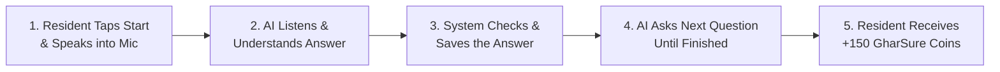

# GharSure AI Voice Survey Pipeline: Simple Guide

## 1. What is the GharSure AI Voice Survey?

The **GharSure AI Voice Survey** allows apartment residents to complete household research surveys simply by speaking, just like a quick phone call, instead of tapping through multiple screens and typing on a phone keyboard.

### Key Things to Know:
* **It is a focused survey interview, not an open-ended chatbot:** The AI is strictly trained to ask approved survey questions, understand the resident's answers, and guide them through to the end.
* **It takes under 4 minutes:** Residents can complete it hands-free while cooking or walking around the house.
* **Real rewards:** Residents earn **+150 GharSure Coins** upon finishing, which they can use for free product trial kits (like washing machine descalers or water filter cartridges) and brand discounts.

---

## 2. The Big Picture: How It Works

---

## 3. The 7-Step Voice Pipeline (In Plain English)

Whenever a resident speaks to the AI, here is what happens behind the scenes:

### Step 1: Listening
* The app listens to the resident through the phone's microphone.
* It automatically detects when the resident finishes talking (after a short, natural pause of less than a second).

### Step 2: Turning Speech into Text
* The resident's voice is instantly turned into written words on the fly.
* It handles Indian accents, everyday household vocabulary, and mixed language (like Hindi and English words together, e.g., *"3 saal se use kar rahe hain"*).

### Step 3: Understanding the Meaning
The system immediately figures out what the resident meant by checking:
* Did they answer the question?
* Did they give a vague answer?
* Did they ask to repeat the question?
* Did they change their mind about an earlier answer?
* Did they ask something unrelated (like the weather)?
* Did they ask to pause or stop?

### Step 4: Converting Words into Clean Data
The system turns conversational phrases into clean, structured facts:
* If the resident says: *"Around three years"* $\rightarrow$ Saved as **3 Years**.
* If the resident says: *"Kent Grand Plus"* $\rightarrow$ Saved as **Brand: Kent, Model: Grand Plus**.
* If the resident says: *"Borewell water"* $\rightarrow$ Saved as **Source: Borewell**.

### Step 5: Checking the Rules (Sanity Check)
Before moving on, the system makes sure the answer makes sense:
* If the question asks for an appliance's age and someone says *"100 years"*, the system knows that's out of range and politely asks again.
* The AI **cannot** make up an answer or guess if it isn't sure.

### Step 6: Asking the Next Question
* Once the answer is saved, the system picks the next logical question based on what the resident said.
* *Example:* If the resident says they have an RO purifier, it asks about filter changes. If they say they don't have one, it skips straight to the next appliance.

### Step 7: Review & Rewarding
* At the end, the resident sees a clear summary of all their answers on screen.
* Once confirmed, **+150 GharSure Coins** are instantly deposited into their wallet.

---

## 4. How the AI Handles Real-Life Situations

Here is how the AI handles everyday situations during an interview:

| What Happens | What the Resident Says | How the AI Responds & What the System Does |
| :--- | :--- | :--- |
| **1. Clear Answer** | *"Around three years."* | Accepts it immediately, confirms warmly (*"Got it, around three years."*), and asks the next question. |
| **2. Vague Answer** | *"Quite a long time."* | Politely clarifies without being pushy: *"Could you estimate roughly how many years or months that has been?"* |
| **3. Unrelated Topic** | *"What's the weather tomorrow?"* | Politely redirects: *"I'm only able to help with your GharSure household study! Could you let me know about your washing machine?"* |
| **4. Extra Details** | *"Three years, and it makes loud noise when spinning."* | Saves "3 years" as the age, and saves the extra note about the noise separately for research. |
| **5. Changing Mind** | *"Wait, earlier I said three years, but actually it's five."* | Updates the earlier answer to 5 years, confirms the change, and returns to the current question. |
| **6. Doesn't Know** | *"I don't know the exact TDS number."* | Respects the answer, marks it as "Not sure", and moves forward without forcing a guess. |
| **7. Asking to Repeat** | *"Can you repeat that?"* | Repeats the exact question clearly without changing the meaning. |
| **8. Wanting to Stop** | *"I need to answer the door, hold on."* | Pauses the survey, saves all progress for up to 48 hours, and lets the resident resume whenever they want. |
| **9. Bad Audio / Noise** | Loud background noise / static | Asks once to repeat. If sound remains poor, offers a 1-tap button to switch to the normal visual screen form. |

---

## 5. Built-in Safety Rules (Keeping It Honest & Secure)

1. **The AI Cannot Invent Anything:** The AI only asks questions that GharSure admins have approved. It cannot invent new questions or give opinions on brands.
2. **The AI Cannot Hand Out Coins on Its Own:** Coins are only added to the resident's wallet by GharSure's secure backend after the full survey is checked.
3. **Complete Privacy (No Voice Recording Kept):** The resident's voice is processed in real time and **never saved as an audio file**. Only the final written survey answers are stored.
4. **Fairness If Not a Match:** If a survey is meant for people with borewell water, but the resident has municipal water, the survey stops early and awards **+10 Coins** as a thank-you for their time.
5. **Always a Choice:** Any resident who prefers not to speak can tap **"Switch to Form"** at any time and finish by tapping on the screen.

---

## 6. What the Resident Sees on Screen

While talking, the resident sees a clean, calm mobile screen:
* An indicator showing whether the AI is speaking or listening.
* The current question written in large, clear text.
* The words they just spoke appearing on screen so they know they were heard correctly.
* Quick buttons at the bottom:
  * **[ 🔄 Repeat ]** — to hear the question again.
  * **[ ⏸ Pause ]** — to save and finish later.
  * **[ 📝 Switch to Form ]** — to type or tap instead of speaking.

---

## 7. Summary of Benefits

* **Zero Typing:** 4 minutes of relaxed talking instead of filling out boring forms.
* **Respectful & Natural:** Understands natural speech and corrections without getting confused.
* **Instant Rewards:** 150 GharSure Coins credited immediately upon completion.
