# GHARSURE FORM-BASED SURVEY REQUIREMENTS SPECIFICATION
**Document Reference:** `GHARSURE-SPEC-SURVEY-2026-V1`  
**Standard Name:** `GHARSURE_FORM_SURVEY_REQUIREMENTS.md`  
**Classification:** Product Architecture, Functional & Technical Specification  
**Status:** `PROPOSED` (incorporating verified `EXISTING` and `PARTIAL` platform features)  
**Target Platform:** GharSure Mobile Application (iOS & Android) & GharSure Admin Console  
**Date of Record:** October 19, 2026  
**Author:** Senior Product Manager, Principal Systems Architect & Senior Full-Stack Engineer  

---

## Executive Summary & Document Control

This specification establishes the authoritative, implementation-ready blueprint for designing, configuring, targeting, delivering, validating, completing, rewarding, and analyzing **form-based surveys** within the **GharSure** household intelligence ecosystem.

GharSure operates as an unbiased, resident-first community knowledge and household intelligence utility for urban Indian gated communities and residential societies. The survey module serves as GharSure's research engine: it empowers GharSure administrators to gather verified, structured ground-truth data on appliances, local water hardness, home maintenance failure points, and household consumer choices, while compensating resident participants transparently via the **GharSure Coin** and rewards ledger.

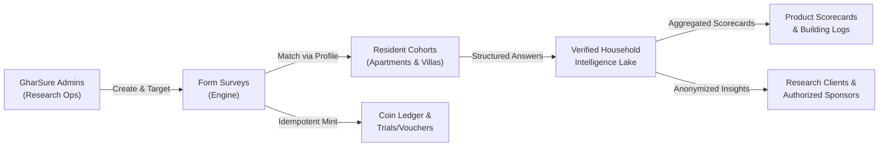

### Document Status Conventions
Throughout this document, every architectural component, field, and workflow is tagged with a normative status label:
* `EXISTING`: Verified as present in existing repository documentation or codebase (`GHARSURE_USER_ACTION_MAP.md`).
* `PARTIAL`: Partially established in current design; extended herein for end-to-end functionality.
* `PROPOSED`: Architecturally designed and recommended herein; ready for engineering implementation.
* `NEEDS_DECISION`: Explicit product, legal, or commercial fork requiring executive sign-off before coding.
* `DEFERRED`: Deliberately isolated and scheduled for post-MVP delivery (e.g., AI Voice / AI Chat modes).

---

## Table of Contents

1. [Section 1: Overview and Objectives](#section-1-overview-and-objectives)
2. [Section 2: Survey Lifecycle](#section-2-survey-lifecycle)
3. [Section 3: Basic Survey Information](#section-3-basic-survey-information)
4. [Section 4: Survey Card and Discovery Experience](#section-4-survey-card-and-discovery-experience)
5. [Section 5: Survey Categories and Feed Layout](#section-5-survey-categories-and-feed-layout)
6. [Section 6: Personalized Survey Recommendations](#section-6-personalized-survey-recommendations)
7. [Section 7: Generic Surveys and Fallback Recommendations](#section-7-generic-surveys-and-fallback-recommendations)
8. [Section 8: Matching, Eligibility, and Ranking Rules](#section-8-matching-eligibility-and-ranking-rules)
9. [Section 9: Audience Targeting and Screening](#section-9-audience-targeting-and-screening)
10. [Section 10: Survey Details and Pre-Start Experience](#section-10-survey-details-and-pre-start-experience)
11. [Section 11: Question Types and Question Schema](#section-11-question-types-and-question-schema)
12. [Section 12: Question Flow, Branching, and Validation](#section-12-question-flow-branching-and-validation)
13. [Section 13: Progress, Saving, and Session Management](#section-13-progress-saving-and-session-management)
14. [Section 14: Reward Configuration and Issuance](#section-14-reward-configuration-and-issuance)
15. [Section 15: Admin Survey Builder](#section-15-admin-survey-builder)
16. [Section 16: Versioning and Campaign Management](#section-16-versioning-and-campaign-management)
17. [Section 17: Data Model and Relationships](#section-17-data-model-and-relationships)
18. [Section 18: API Contracts and Backend Behavior](#section-18-api-contracts-and-backend-behavior)
19. [Section 19: Privacy, Security, and Access Control](#section-19-privacy-security-and-access-control)
20. [Section 20: Analytics and Reporting](#section-20-analytics-and-reporting)
21. [Section 21: Notifications and Reminders](#section-21-notifications-and-reminders)
22. [Section 22: QA and Acceptance Criteria](#section-22-qa-and-acceptance-criteria)
23. [Section 23: MVP Priorities and Dependencies](#section-23-mvp-priorities-and-dependencies)
24. [Section 24: Open Decisions and Traceability](#section-24-open-decisions-and-traceability)

---

## Section 1: Overview and Objectives

### 1.1 Purpose of Form-Based Surveys in GharSure
`Status: EXISTING (Conceptual Alignment) / PROPOSED (System Specification)`  
`Requirement ID: FORM-CORE-001`

GharSure's primary value proposition is unmasking ground reality for urban Indian homeowners and tenants—delivering independent appliance longevity data, society-level water hardness benchmarks, and transparent cost-of-ownership models. High-quality consumer studies are vital to maintaining this data moat.

The **Form-Based Survey System** provides a structured, low-friction, mobile-optimized data collection channel. Unlike commercial survey panels that spam users with irrelevant FMCG questionnaires, GharSure surveys are:
1. **Hyper-Contextual:** Directly anchored to the resident's verified home context (e.g., apartment complex, local water source, registered appliance inventory).
2. **Value-Reciprocal:** Compensating participants immediately with GharSure Coins, unlocking free physical product trials, brand vouchers, and community intelligence unlocks.
3. **Evidence-Generating:** Powering the 5-pillar GharSure Scorecards (Build Quality, Functional Efficiency, Serviceability, 3-Year Cost of Ownership, Verified Resident Feedback) shown in Tab 1 (Discover).

### 1.2 Target Users and Their Goals

| User Persona | Key Attributes & Context | Primary Goals in Survey Module | Status |
| :--- | :--- | :--- | :--- |
| **GharSure Resident (Consumer)** | Apartment / Villa resident; verified phone OTP; has registered home profile (water source, appliances). | Complete fast, relevant surveys (under 5 mins); earn GharSure Coins; unlock free trials; avoid spam; contribute to building knowledge. | `EXISTING` |
| **GharSure Admin (Research Ops)** | Internal GharSure operations and research team member; full role-based access. | Design surveys; configure targeting logic; set reward budgets; inspect response quality; publish/pause campaigns; export datasets. | `PROPOSED` |
| **Brand Sponsor / Research Client** | Third-party appliance brand, water tech manufacturer, or eco-cleaning D2C brand. | Access aggregated cohort sentiment; test product positioning; sponsor trial kits. **Strict Boundary:** No survey creation or direct resident contact rights. | `PROPOSED` |

> [!IMPORTANT]
> **Strict Administrative Boundary:** Third-party brands and research clients **NEVER** receive administrative access to create, publish, or directly query surveys. All surveys are created, curated, and vetted by GharSure Administrators to safeguard user trust, enforce privacy guarantees under the Digital Personal Data Protection (DPDP) Act 2023, and maintain editorial independence.

### 1.3 Business Goals and Consumer Value Proposition

#### Business Objectives
* **Generate Empirical Product Intelligence:** Collect verified performance logs (e.g., RO membrane lifespan under 800+ ppm borewell water) to continuously calibrate GharSure Scorecards.
* **Fuel the Zero-Cost Trial Flywheel:** Feed qualified user cohorts into product trials (Tab 2, Sub-Tab 2), enabling brands to sample high-intent consumers without intermediary ad networks.
* **Deepen Household Asset Profiles:** Use surveys as progressive profiling touchpoints to expand known appliance assets, service dates, and purchase intentions.

#### Consumer Value Proposition
* **Zero Spam:** Users only see surveys for which their household genuinely qualifies.
* **Instant, Immutable Rewards:** Completed surveys credit verified GharSure Coins directly into the user's ledger within 500ms of submission.
* **Fair Disqualification Compensation:** Users screened out by conditional screener questions receive a guaranteed baseline reward (10 Coins) for their time.

### 1.4 MVP Scope vs. Explicit Exclusions

```
┌────────────────────────────────────────────────────────────────────────┐
│                        SURVEY SYSTEM MVP BOUNDARIES                    │
├───────────────────────────────────┬────────────────────────────────────┤
│ IN SCOPE (MVP - Phase 1)          │ EXPLICIT EXCLUSIONS (Post-MVP)     │
├───────────────────────────────────┼────────────────────────────────────┤
│ • Mobile form-based survey runner │ • AI conversational text surveys   │
│ • Single-question stepper UX      │ • AI voice-guided surveys          │
│ • 9 core question types           │ • Brand self-serve portal          │
│ • Household attribute targeting   │ • Drag-and-drop ranking questions  │
│ • Screener qualification & coins  │ • Automated audio transcription    │
│ • 48-hour Save & Resume           │ • Real-time brand telemetry webhooks│
│ • Coin ledger credit integration  │ • External monetary cash-out       │
│ • Admin draft, publish & quotas   │ • Dynamic ML personalized weighting│
│ • Anonymized CSV/JSON data export │ • Native tablet split-screen runner│
└───────────────────────────────────┴────────────────────────────────────┘
```

### 1.5 Interplay with Existing GharSure Modules
`Status: EXISTING (Cross-Referenced to GHARSURE_USER_ACTION_MAP.md)`

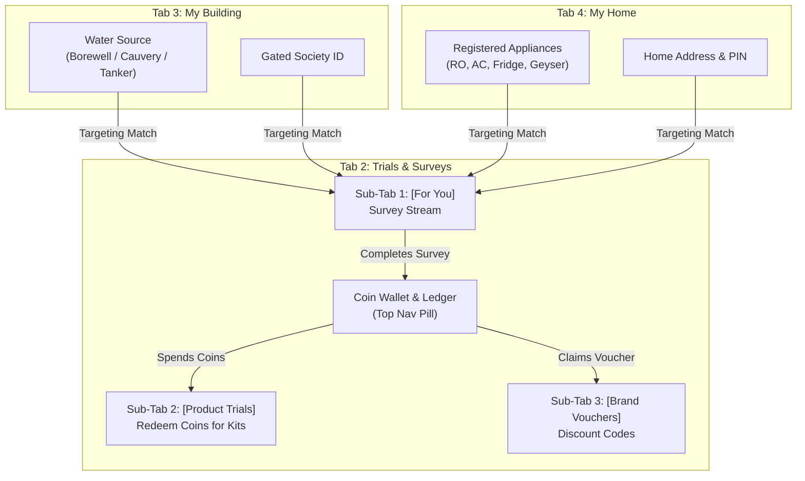

1. **Trials & Surveys Hub (Tab 2, Sub-Tab 1: For You):** Form surveys live as cards inside the "For You" stream (`GHARSURE_USER_ACTION_MAP.md` line 184).
2. **GharSure Coins & Ledger (`GHARSURE_USER_ACTION_MAP.md` line 179):** The primary incentive currency. Survey rewards credit directly to this ledger.
3. **Product Trials vs. Surveys Distinction:**
   * **Survey Participation:** Resident invests 2–5 minutes of attention to provide answers $\rightarrow$ **Earns Coins** (+150 Coins).
   * **Product Trial Redemption:** Resident spends accumulated coins $\rightarrow$ **Deducts Coins** (-200 Coins) to receive a physical trial kit (e.g., Plant-based descaler pack worth ₹399).
4. **Household & Appliance Personalization (Tab 4 & Onboarding):** Appliances registered in "My Home" and water source selected during onboarding directly drive survey eligibility.

### 1.6 Architectural Future-Proofing for AI Modes
`Status: PROPOSED`  
`Requirement ID: FORM-CORE-002`

The schema and engine designed herein separate **Survey Definition & Logic** from **Session Presentation Mode**. While MVP executes purely in `mode: "FORM"`, future releases will plug in `mode: "AI_TEXT_CHAT"` and `mode: "AI_VOICE"` without re-engineering survey metadata, branching logic, target cohorts, or the reward ledger.

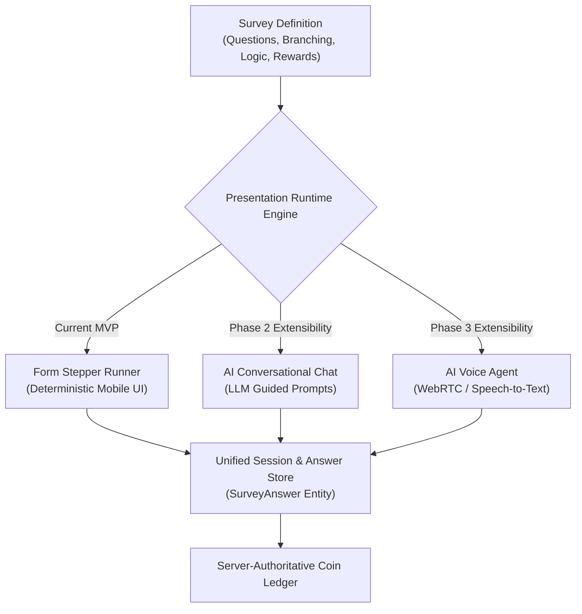

### 1.7 Glossary of Standard Terms

| Term | Formal Platform Definition | Status |
| :--- | :--- | :--- |
| **GharSure Coin** | The internal, non-inflationary virtual currency awarded to residents for verified community contributions and surveys. | `EXISTING` |
| **Coin Ledger** | An append-only, immutable transaction ledger tracking all coin credits, debits, reference IDs, and running balances. | `EXISTING` |
| **Screener Question** | An upfront survey question that deterministically tests if a participant meets mandatory, unprofiled campaign criteria. | `PROPOSED` |
| **Screener Disqualification (DQ)** | The state where a participant fails a screener question, ending the survey early while awarding a baseline consolation reward (+10 Coins). | `EXISTING` |
| **DAG Branching** | Directed Acyclic Graph logic dictating conditional jumps between questions without allowing infinite circular loops. | `PROPOSED` |
| **Save & Resume** | The mechanism allowing a resident to exit an incomplete survey and resume it within a strict 48-hour expiration window. | `EXISTING` |
| **Campaign Response Quota** | The maximum number of successful, qualified completions permitted for a campaign before it automatically closes. | `PROPOSED` |
| **k-Anonymity Threshold** | Privacy standard requiring that reported survey groupings contain at least $k=10$ distinct respondents to prevent de-anonymization. | `PROPOSED` |
| **DPDP Act 2023** | India's Digital Personal Data Protection Act 2023, governing lawful consent, purpose limitation, and data erasure rights. | `EXISTING` |

### 1.8 Assumptions and Constraints

* **Platform Environment:** Native mobile clients (React Native / Flutter) communicating with a Node.js / NestJS or Go microservices backend over HTTPS/REST with PostgreSQL and Redis.
* **Network Realities:** Urban Indian mobile connections face transient 4G/5G latency in basements and elevators; offline draft persistence and idempotent submissions are mandatory.
* **Single Active Device:** A user can only maintain one active survey session per campaign at any given time.

---

## Section 2: Survey Lifecycle

`Status: PROPOSED (Architectural Lifecycle Model)`  
`Requirement ID: FORM-LIFE-001`

To prevent data corruption, preserve the integrity of user rewards, and ensure analytical validity, surveys transition through a deterministic finite-state machine (FSM).

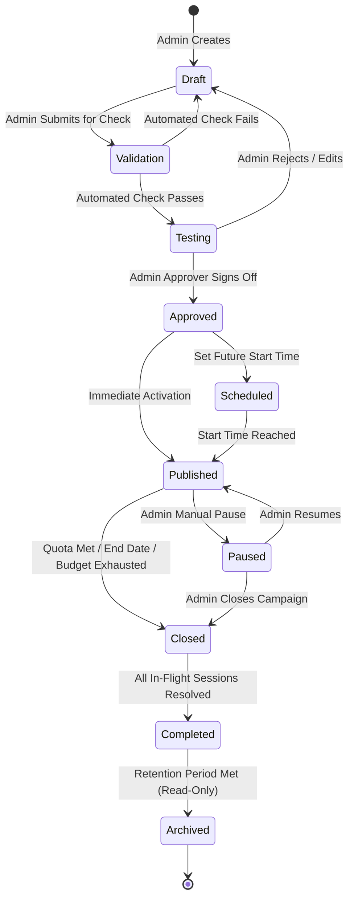

### 2.1 Permitted Lifecycle Transitions

| Current State | Target State | Triggering Actor | Pre-Conditions & Validation Guards | Session Impact | Audit Log Required |
| :--- | :--- | :--- | :--- | :--- | :--- |
| `DRAFT` | `VALIDATION` | Admin Author | Minimum 1 valid question defined; reward configured; targeting rules defined. | None (No user access). | Yes |
| `VALIDATION` | `TESTING` | System Engine | Schema validation succeeds; DAG contains no cycles or dead ends; quota > 0. | None. | Yes |
| `VALIDATION` | `DRAFT` | System Engine | Validation errors encountered (e.g., broken branching rule, missing text). | None. | Yes |
| `TESTING` | `APPROVED` | Research Super-Admin | Test session executed successfully; mobile preview approved; consent copy verified. | Internal test data created only. | Yes |
| `APPROVED` | `SCHEDULED` | Admin Operations | Future `start_time` provided; campaign coin budget reserved in treasury. | None. | Yes |
| `APPROVED` | `PUBLISHED` | Admin Operations | `start_time <= NOW()`; coin budget locked; response quota available. | Survey becomes discoverable in user feed. | Yes |
| `SCHEDULED` | `PUBLISHED` | System Worker | Cron / Scheduler detects `start_time <= NOW()`; checks quota & budget. | Survey becomes discoverable in user feed. | Yes |
| `PUBLISHED` | `PAUSED` | Admin Operations | Emergency freeze or mid-campaign review triggered. | New starts blocked; in-flight sessions granted 1-hour grace to finish. | Yes |
| `PAUSED` | `PUBLISHED` | Admin Operations | Issue resolved; quota and dates updated if necessary. | Discovery restored; new starts permitted. | Yes |
| `PUBLISHED` | `CLOSED` | System Worker / Admin | Triggered if `NOW() >= end_time`, or `completed_count >= quota`, or budget empty. | New starts blocked; in-flight sessions allowed to finish within 48h window. | Yes |
| `CLOSED` | `COMPLETED` | System Worker | All active sessions either reached `SUBMITTED`, `DISQUALIFIED`, or `EXPIRED`. | Dataset marked frozen; analytical aggregations calculated. | Yes |
| `COMPLETED` | `ARCHIVED` | System Worker | 90 days elapsed since completion; raw data archived/purged per DPDP policy. | Read-only in admin reports; hidden from all user views. | Yes |

### 2.2 Validation Engine Gates Prior to Publishing
Before any survey transitions from `DRAFT` to `APPROVED`, the backend validation runner enforces the following mandatory assertions:
1. **Structural Completeness:** Must contain at least one question.
2. **DAG Integrity:** Branching graph must be acyclic. Every path must terminate at an explicit End Survey node.
3. **Option Uniqueness:** Option identifiers within single/multi-choice questions must be unique.
4. **Reward Solvency:** Campaign reward budget must be mathematically sufficient:
   $$\text{Required Budget} = (\text{Quota} \times \text{Completion Reward}) + (\text{Est. Disqualifications} \times 10 \text{ Coins})$$
5. **Audience Validity:** Targeting criteria must resolve to at least 50 eligible active users in the selected geographic area to prevent zero-impression ghost campaigns.
6. **DPDP Compliance Notice:** Data usage statement and purpose disclosure must be present.

### 2.3 Handling Active In-Flight Sessions During State Shifts
`Requirement ID: FORM-LIFE-002`

* **When a Survey is PAUSED:**
  * Users in the feed who have not started see the card disappear or transition to "Temporarily Paused".
  * Users with active sessions in progress (`IN_PROGRESS`) are granted an unextended **1-hour grace period** to complete their submission. Responses submitted within the grace period receive full rewards.
* **When a Survey is CLOSED (Quota Reached / Expired):**
  * New sessions are strictly rejected with HTTP `409 Conflict` (`CAMPAIGN_CLOSED`).
  * In-progress sessions already initialized before the closure timestamp are allowed to finish within their standard 48-hour session window. A 5% buffer quota is reserved in campaign budgets to absorb in-flight finishes.
* **When a Survey Version is UPDATED:**
  * In-flight sessions are **pinned** to the immutable `version_id` under which they were initiated. They are never forced into a newer version mid-session.

---

## Section 3: Basic Survey Information

`Status: PROPOSED`  
`Requirement ID: FORM-META-001`

Every survey entity maintains strict separation between **Consumer-Visible Metadata** (rendered in the mobile client) and **Internal Governance Metadata** (restricted to administrative views and audit trails).

### 3.1 Metadata Specification Matrix

| Field Name | System Key | Data Type | Required | Visibility | Default Value | Editable Post-Publish | Validation Rules & Constraints |
| :--- | :--- | :--- | :--- | :--- | :--- | :--- | :--- |
| **Survey ID** | `survey_id` | `UUIDv4` | Yes | All | Generated | No | Primary key, RFC 4122 compliant. |
| **Survey Title** | `title` | `VARCHAR(100)` | Yes | Consumer & Admin | None | Minor Only | 5–100 characters; clear, resident-friendly naming. |
| **Short Description** | `short_description` | `VARCHAR(160)` | Yes | Consumer & Admin | None | Minor Only | Max 160 characters; appears on feed cards. |
| **Full Description** | `full_description` | `TEXT` | Yes | Consumer & Admin | None | Minor Only | Explains research purpose, scope, and instructions. |
| **Survey Category** | `category_code` | `VARCHAR(50)` | Yes | Consumer & Admin | None | No | Must exist in standard Category Taxonomy (Section 5). |
| **Cover Thumbnail** | `cover_image_url` | `VARCHAR(512)` | Yes | Consumer & Admin | Default Icon | Yes | Valid HTTPS URL to CDN; 16:9 ratio, max 1MB. |
| **Internal Objective** | `internal_objective` | `TEXT` | Yes | **Admin Only** | None | Yes | Confidential research hypothesis & goal. |
| **Business Outcome** | `intended_outcome` | `TEXT` | Yes | **Admin Only** | None | Yes | Anticipated commercial / product roadmap impact. |
| **Client / Sponsor** | `sponsor_name` | `VARCHAR(120)` | No | Consumer & Admin | None | No | Brand/entity funding the study; disclosed if required. |
| **Sponsor Disclosure** | `is_sponsor_disclosed`| `BOOLEAN` | Yes | Consumer & Admin | `false` | No | If true, sponsor name renders on detail sheet. |
| **Created By Admin** | `created_by` | `UUIDv4` | Yes | **Admin Only** | Context User | No | Admin user ID of author. |
| **Created Timestamp** | `created_at` | `TIMESTAMPTZ` | Yes | **Admin Only** | `NOW()` | No | UTC timestamp. |
| **Updated Timestamp** | `updated_at` | `TIMESTAMPTZ` | Yes | **Admin Only** | `NOW()` | Auto | Updated on every mutation. |
| **Survey Mode** | `mode` | `ENUM` | Yes | Consumer & Admin | `'FORM'` | No | `'FORM'`, `'AI_TEXT'`, `'AI_VOICE'`. Locked to `'FORM'` for MVP. |
| **Supported Languages**| `languages` | `VARCHAR(10)[]`| Yes | Consumer & Admin | `['en']` | Yes | ISO 639-1 language codes (e.g., `['en', 'hi', 'kn']`). |
| **Estimated Duration** | `estimated_duration` | `INT` | Yes | Consumer & Admin | `3` | Minor Only | 1 to 20 minutes; validated against actual completion logs. |
| **Start Time** | `start_time` | `TIMESTAMPTZ` | Yes | Consumer & Admin | Immediate | Before start | UTC activation timestamp. |
| **End Time** | `end_time` | `TIMESTAMPTZ` | Yes | Consumer & Admin | `start + 14d`| Yes | Must be $> \text{start\_time}$. |
| **Response Quota** | `quota_limit` | `INT` | Yes | Consumer & Admin | `500` | Can increase | Target number of qualified completions (50 to 50,000). |
| **Survey Status** | `status` | `ENUM` | Yes | Consumer & Admin | `'DRAFT'` | State Machine | Matches Section 2 Lifecycle FSM. |
| **Survey Version** | `version` | `VARCHAR(10)` | Yes | Consumer & Admin | `'1.0.0'` | Auto | Semantic versioning. |
| **Internal Notes** | `internal_notes` | `TEXT` | No | **Admin Only** | `NULL` | Yes | Administrative scratchpad, tags, or campaign notes. |
| **Taxonomy Tags** | `tags` | `VARCHAR(50)[]` | No | Consumer & Admin | `[]` | Yes | Max 10 tags for search indexing. |
| **Close Reason** | `close_reason` | `VARCHAR(50)` | No | **Admin Only** | `NULL` | On Closure | `'QUOTA_MET'`, `'EXPIRED'`, `'MANUAL_ADMIN'`, `'BUDGET'`. |

> [!CAUTION]
> **Data Leak Prevention:** Under no circumstances should `internal_objective`, `intended_outcome`, `internal_notes`, or raw SQL audience targeting queries be returned over consumer API endpoints (`/api/v1/surveys/*`). These are strictly stripped by backend Data Transfer Object (DTO) serializers.

---

## Section 4: Survey Card and Discovery Experience

`Status: EXISTING (Layout Concept in GHARSURE_USER_ACTION_MAP.md line 184) / PROPOSED (Detailed State Specification)`  
`Requirement ID: FORM-DISC-001`

Surveys appear inside **Tab 2 (Trials & Surveys)** under the **[For You]** segmented sub-navigation bar. Each survey renders as a high-density, interactive card optimized for vertical scrolling.

### 4.1 Visual Hierarchy & Component Wireframe

```
┌────────────────────────────────────────────────────────┐
│ [ Water & Filtration ]                  [ 4 Mins ] ⏱  │
│                                                        │
│ Bangalore Monsoon Borewell Water Study                 │
│ Share your RO filter replacement interval and TDS data │
│                                                        │
│ 🏷 Matched: Owns RO Purifier in Bangalore              │
│ 💰 Earn +150 GharSure Coins                            │
│                                                        │
│ ────────────────────────────────────────────────────── │
│ 📅 Closes in 2 days          [ Start Survey  ( +150 ) ] │
└────────────────────────────────────────────────────────┘
```

### 4.2 Survey Card Information Elements

1. **Category Tag (Top Left):** Color-coded pill reflecting the primary category (e.g., *Water & Filtration* in cyan, *Appliances* in orange).
2. **Estimated Duration (Top Right):** Standardized time pill (e.g., `⏱ 4 mins`).
3. **Survey Title:** Bold heading, max 2 lines (e.g., *Bangalore Monsoon Borewell Water Study*).
4. **Short Description:** Secondary descriptive text, max 2 lines.
5. **Personalization Reason Chip:** Transparent matching explanation (e.g., `🏷 Recommended for you: Registered RO Purifier`).
6. **Reward Value Pill:** Prominent coin badge indicating potential reward (e.g., `💰 +150 Coins`).
7. **Sponsor / Independence Disclosure:** Micro-text indicating whether it is an independent GharSure study or conducted with a disclosed research partner.
8. **Dynamic Action CTA (Bottom Right):** Interactive touch target that dynamically reflects the user's relationship with that survey session.

### 4.3 State-by-State Survey Card Behavior

| State | User Experience & UI Representation | Primary Action CTA | CTA Enabled? |
| :--- | :--- | :--- | :--- |
| **Available (Not Started)** | Card displayed in active styling; reward badge highlighted in GharSure orange. | **"Start Survey"** | Yes |
| **In-Progress (Draft Exists)** | Card displays visual progress bar (e.g., `Question 3 of 6`); shows elapsed time. | **"Continue (Q3/6)"** | Yes |
| **Completed (Rewarded)** | Card shifted to muted background; displays green checkmark badge: `Completed (+150 Coins Credited)`. | **"View Summary"** | No (Non-restartable) |
| **Screened Out (DQ)** | Card displays grey badge: `Not Qualified (+10 Coins Credited)`. Suppressed from active feed after 24h. | **"Completed"** | No |
| **Paused Campaign** | Card visually dimmed; displays banner: `Temporarily Paused by Moderator`. | **"Paused"** | No |
| **Expired / Closed** | Card displays red/grey banner: `Campaign Closed`. Suppressed from feed upon pull-to-refresh. | **"Closed"** | No |
| **Ineligible (Target Mismatch)**| **Suppressed completely from feed.** If accessed via external deep link, renders pre-screen message: *"This study is restricted to residents with specific household configurations."* | **"Browse Feed"** | Redirects to Feed |

---

## Section 5: Survey Categories and Feed Layout

`Status: PROPOSED`  
`Requirement ID: FORM-DISC-002`

To maintain clean discovery and prevent cognitive overload, surveys are categorized under a configurable, household-centric taxonomy.

### 5.1 Standard Household Category Taxonomy

| Category Code | Display Name | Household Domain Context | Example Research Focus Areas |
| :--- | :--- | :--- | :--- |
| `WATER_FILTRATION` | Water & Filtration | Home drinking water, borewell/tanker supply, TDS, purifiers. | RO filter change intervals, membrane scaling, UV/UF efficacy. |
| `APPLIANCES` | Appliances & Longevity | Major home appliances registered in "My Home" registry. | Inverter AC PCB failures, washing machine vibration, fridge defrost. |
| `CLEANING_HYGIENE` | Cleaning & Hygiene | Domestic hygiene chemicals, surface care, dishwashing. | Dishwasher detergent efficacy in hard water, tap descalers. |
| `HOME_MAINTENANCE` | Maintenance & Seepage | Building structural upkeep, waterproofing, painting. | External wall dampness, bathroom tile leakage, sealant life. |
| `HOME_SERVICES` | Home Services & Labor | Technicians, maid/cook services, local service satisfaction. | Urban Company service quality vs. local independent handymen. |
| `HOUSEHOLD_SPENDING`| Household Economics | Monthly utility expenses, power tariffs, grocery subscriptions. | Summer electricity bill spikes, bulk water tanker delivery costs. |
| `PRODUCT_DISCOVERY` | Product & Brand Intent | Buying intentions, product upgrades, brand switching. | Planned AC replacement, adoption of smart IoT door locks. |
| `HOME_MOVING` | Move-In & Relocation | Apartment onboarding, handover friction, society logistics. | Tenant move-in painting costs, society association move-in fees. |
| `GENERAL_RESEARCH` | General Household | Broad demographic benchmarks and resident lifestyle. | Household size, pet ownership habits, waste segregation. |

### 5.2 Category Assignment and Tagging Rules
* Every survey must have exactly **one Primary Category** (used for top-level filtering and analytics rollup).
* Every survey may specify up to **five Secondary Tags** (e.g., `['borewell', 'kent', 'ro-membrane']`) used by the search index.
* Admins can introduce new categories via the Admin Settings without database schema migration (backed by a dynamic `lookup_categories` table).

### 5.3 Feed Layout, Filtering, and Pagination

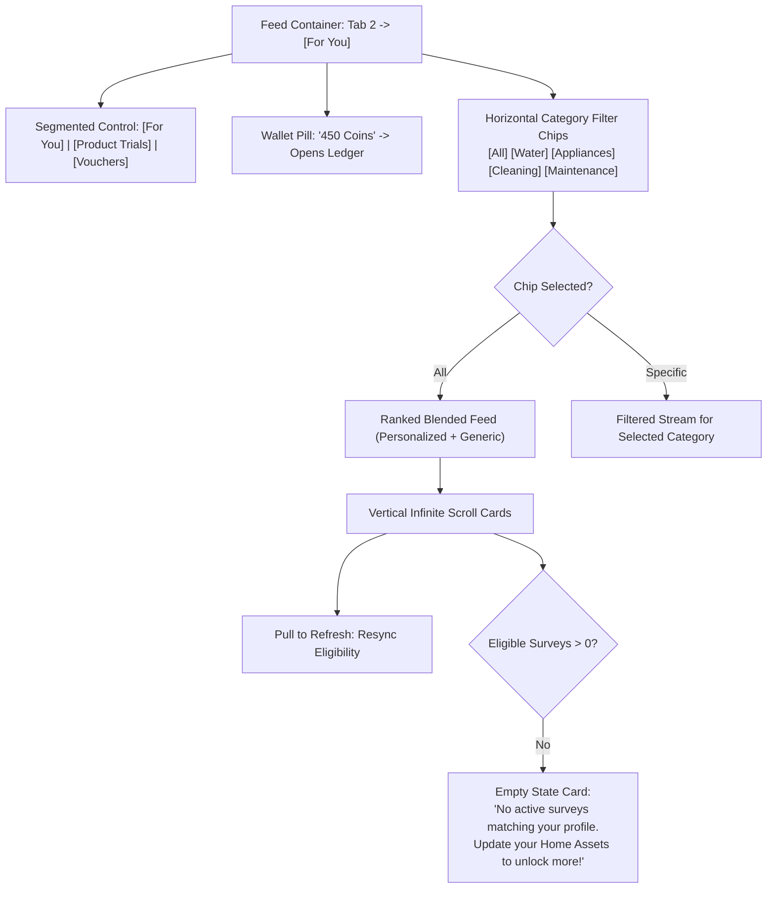

* **Filter Bar:** Horizontal swipeable chips below the segmented sub-nav. Selecting a chip filters the list in place without full page reloads.
* **Pagination:** Keyspace cursor-based pagination (`limit=10`, `cursor=created_at_uuid`) to guarantee consistent mobile feed scrolling without duplicate cards.
* **Search Functionality:** Top sticky search icon enables client-side text filtering against survey titles, descriptions, and tags.

---

## Section 6: Personalized Survey Recommendations

`Status: PARTIAL (Context defined in GHARSURE_USER_ACTION_MAP.md) / PROPOSED (Engine Spec)`  
`Requirement ID: FORM-MATCH-001`

GharSure's primary differentiator is **Zero-Spam Personalization**. Instead of generic broadcast surveys, the platform matches research campaigns to the consumer's verified household profile.

### 6.1 Available Household Profile Attributes Matrix

| Profile Attribute | Source in GharSure Architecture | Field Key | Verified Status | Sample Values |
| :--- | :--- | :--- | :--- | :--- |
| **Registered Appliances** | Tab 4 ("My Home") Asset Registry | `user_appliances` | `EXISTING` | `['RO_PURIFIER', 'AIR_CONDITIONER']` |
| **Appliance Brand & Model** | Tab 4 Add Appliance Autocomplete | `appliance_details` | `EXISTING` | Brand: `Kent`, Model: `Grand Plus` |
| **Appliance Install Date** | Tab 4 Native Mobile Date Picker | `appliance_age_months`| `EXISTING` | `24` (Calculated from install date) |
| **Household Water Source** | Onboarding Screen 8 Multi-Select Chips | `water_sources` | `EXISTING` | `['BOREWELL', 'TANKER']` |
| **Home Architecture Type** | Onboarding Screen 6 Card Selection | `home_type` | `EXISTING` | `'APARTMENT'`, `'INDEPENDENT'`, `'VILLA'` |
| **Gated Society Name / ID**| Onboarding Screen 7 Society Search | `society_id` | `EXISTING` | `SOC-BLR-0042` (*Prestige Falcon City*) |
| **City & PIN Code** | Onboarding Screen 5 Quick-Select/Input | `pincode`, `city` | `EXISTING` | `560062`, `'Bangalore'` |
| **Household Role** | Profile Drawer (Member Management) | `household_role` | `EXISTING` | `'ADMIN'` (Primary), `'MEMBER'` (Spouse) |
| **Household Size** | Survey Screener / Profile Enrichment | `household_size` | `PROPOSED` | `3` (Adults: 2, Children: 1) |
| **Home Ownership Status** | Profile Drawer / Settings | `occupancy_type` | `PROPOSED` | `'OWNER'`, `'TENANT'` |
| **Stated Purchase Intent** | Discover Tab Bookmarks / Search Tags | `purchase_intents` | `PROPOSED` | `['BUY_WATER_SOFTENER']` |

### 6.2 Data Enrichment vs. Profile Corrections
* **Missing Attributes:** If a campaign targets an attribute not yet recorded in the resident's profile (e.g., *Occupancy Type: Tenant*), the survey must **NOT** be hidden. Instead, the attribute is handled via a **Screener Question** during survey entry.
* **Progressive Profile Enrichment:** Upon successful survey completion, declarative screener answers (e.g., *"I rent this flat"*) are written back to the user's core household profile (with explicit consent), eliminating redundant questions in future campaigns.
* **Profile Corrections:** Residents can tap their profile chip directly from any recommendation card to update out-of-date appliances or water sources in "My Home" (Tab 4).

### 6.3 Recommendation Explanation Engine
To build consumer trust, every personalized survey card must compute and display an algorithmic **Reason String**.

| Matching Condition Triggered | User-Facing Recommendation Explanation |
| :--- | :--- |
| User owns an RO Purifier of brand *Kent* | `🏷 Recommended because you registered a Kent RO Purifier` |
| User household receives *Borewell* water | `🏷 Recommended for homes with Borewell water supply` |
| User resides in *Prestige Falcon City* | `🏷 Special study for Prestige Falcon City residents` |
| User registered an AC older than 36 months | `🏷 Matched to your 3-year-old Air Conditioner` |

---

## Section 7: Generic Surveys and Fallback Recommendations

`Status: PROPOSED`  
`Requirement ID: FORM-MATCH-002`

To guarantee that new residents (who may have skipped appliance registration during onboarding) do not encounter an empty, demotivating screen, the system supports **Generic Surveys** with a deterministic fallback pipeline.

### 7.1 Definition and Boundaries of Generic Surveys
* A **Generic Survey** is defined as any survey campaign where the Admin has explicitly flagged `is_broad_audience: true` and configured zero appliance or building prerequisites.
* **Crucial Distinction:** Generic availability does **NOT** imply unconstrained eligibility. A generic survey may still enforce broad geographic gates (e.g., `city = 'Bangalore'`), age requirements ($18+$), campaign response quotas, and prior completion restrictions.

### 7.2 Fallback and Feed Blending Mechanism

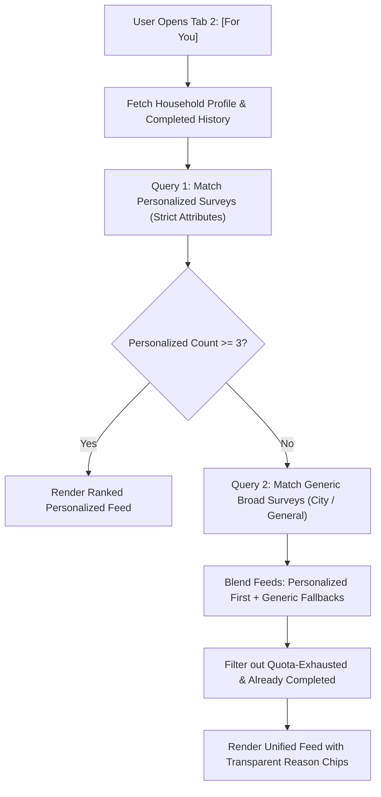

### 7.3 Anti-Fatigue Rules for Broad Surveys
1. **Exposure Cap:** A user cannot be shown more than **two generic surveys** simultaneously in their feed.
2. **Category Diversity:** If two generic surveys are displayed, they must belong to distinct Primary Categories (e.g., one *Cleaning & Hygiene*, one *General Research*).
3. **Suppression on Dismissal:** If a user swipes to dismiss or explicitly hides a generic survey, it is suppressed from their feed for 14 days.

---

## Section 8: Matching, Eligibility, and Ranking Rules

`Status: PROPOSED`  
`Requirement ID: FORM-MATCH-003`

The delivery of surveys operates across two strictly decoupled algorithmic phases: **Phase A (Eligibility Filtering)** and **Phase B (Relevance Ranking)**.

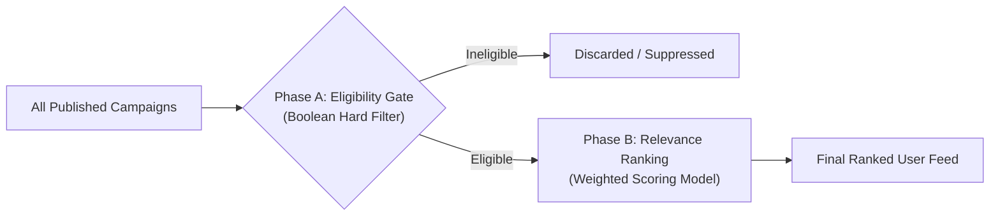

### 8.1 Phase A: Eligibility Filtering (Boolean Hard Gates)
A user is either strictly **ELIGIBLE** or **INELIGIBLE**. If any single hard gate fails, the survey is discarded from the user's feed before ranking.

$$\text{Eligible} = G_{\text{Status}} \land G_{\text{Geo}} \land G_{\text{Profile}} \land G_{\text{Quota}} \land G_{\text{History}} \land G_{\text{Consent}}$$

1. **Campaign Status Gate ($G_{\text{Status}}$):** Survey must be in `PUBLISHED` state, with $\text{start\_time} \le \text{NOW}() < \text{end\_time}$.
2. **Geographic Gate ($G_{\text{Geo}}$):** User's registered PIN code or city must match the campaign's inclusion list (or match wildcard `*`).
3. **Profile Attribute Gate ($G_{\text{Profile}}$):** User's household attributes must satisfy the targeting criteria (e.g., `water_source CONTAINS 'BOREWELL'`).
4. **Quota Availability Gate ($G_{\text{Quota}}$):** Current completed count must be less than `quota_limit`.
5. **Deduplication Gate ($G_{\text{History}}$):** User ID must **NOT** exist in `survey_sessions` with state `SUBMITTED` or `SCREENER_DISQUALIFIED` for this `survey_id`.
6. **DPDP Consent Gate ($G_{\text{Consent}}$):** User must not have revoked general research participation consent in the Privacy Center.

### 8.2 Phase B: Relevance Ranking (Scoring Model)
Eligible surveys are scored dynamically to determine their vertical display order.

> [!NOTE]
> **Hypothesis Formulation:** The scoring weights below represent an architectural baseline hypothesis. They are declared as configuration variables in the ranking service and will be calibrated empirically using A/B testing against start-rate metrics.

$$\text{Score} = (w_1 \cdot S_{\text{Household}}) + (w_2 \cdot S_{\text{RewardEffort}}) + (w_3 \cdot S_{\text{Urgency}}) + (w_4 \cdot S_{\text{Intent}}) - P_{\text{Fatigue}}$$

| Scoring Component | Weight ($w_i$) | Component Evaluation Criteria | Mathematical Formulation |
| :--- | :--- | :--- | :--- |
| **Household Match ($S_{\text{Household}}$)** | **0.35** | Depth of match to registered assets in "My Home". | $1.0$ (Brand+Model match), $0.7$ (Category match), $0.4$ (Generic). |
| **Reward / Effort ($S_{\text{RewardEffort}}$)** | **0.25** | Incentive value per minute of estimated participant time. | $\min\left(1.0, \frac{\text{Coins} / \text{Minutes}}{50}\right)$ |
| **Campaign Urgency ($S_{\text{Urgency}}$)** | **0.20** | Proximity to closing time and remaining quota availability. | $\frac{\text{Remaining Quota}}{\text{Total Quota}} \times \left(1.0 - \frac{\text{Remaining Hours}}{\text{Total Hours}}\right)$ |
| **Recent Intent ($S_{\text{Intent}}$)** | **0.15** | Correlation with user's recent app activity (searches, tasks).| $1.0$ if category searched in last 7 days; else $0.0$. |
| **Fatigue Penalty ($P_{\text{Fatigue}}$)** | **Deduction** | Penalizes surveys shown repeatedly without interaction. | $0.05 \times \text{Impressions Without Start}$ (Capped at $0.30$). |

### 8.3 Deterministic Tie-Breaking
If two competing surveys produce an identical computed `Score` (within a $\pm 0.001$ delta), ties are resolved deterministically:
1. **Higher Absolute Coin Reward** wins.
2. **Shorter Estimated Duration** wins.
3. **Earlier Expiration Timestamp** wins.
4. **Lexicographical Sort on `survey_id` UUID** (Absolute deterministic guarantee).

---

## Section 9: Audience Targeting and Screening

`Status: PROPOSED`  
`Requirement ID: FORM-TARG-001`

Administrators configure audience targeting rules via a structured, JSON-based rule specification interface in the Admin Console.

### 9.1 Targeting Condition Operators

The backend rule evaluation engine supports standard declarative operators:

```
┌────────────────────────────────────────────────────────┐
│                   SUPPORTED OPERATORS                  │
├─────────────────┬──────────────────────────────────────┤
│ EQUALS          │ Exact scalar match (e.g. city)       │
│ NOT_EQUALS      │ Negative scalar match                │
│ IN              │ Value exists in target array         │
│ NOT_IN          │ Value does not exist in target array │
│ CONTAINS_ANY    │ Set intersection size >= 1           │
│ CONTAINS_ALL    │ Target set is subset of user set     │
│ GREATER_THAN    │ Numeric comparison (e.g. age)        │
│ LESS_THAN       │ Numeric comparison                   │
│ BETWEEN         │ Range inclusion: [min, max]          │
└─────────────────┴──────────────────────────────────────┘
```

### 9.2 Compound Rule Schema Example (JSON)
Targeting configurations are expressed as trees of conjunctions (`AND`) and disjunctions (`OR`):

```json
{
  "conjunction": "AND",
  "rules": [
    {
      "field": "user.city",
      "operator": "IN",
      "value": ["Bangalore", "Hyderabad"]
    },
    {
      "field": "household.water_sources",
      "operator": "CONTAINS_ANY",
      "value": ["BOREWELL", "PRIVATE_TANKER"]
    },
    {
      "conjunction": "OR",
      "rules": [
        {
          "field": "appliances.category",
          "operator": "IN",
          "value": ["RO_WATER_PURIFIER"]
        },
        {
          "field": "household.home_type",
          "operator": "EQUALS",
          "value": "APARTMENT"
        }
      ]
    }
  ]
}
```

### 9.3 In-Survey Screener Questions and Disqualification (DQ)
`Status: EXISTING (Disqualification screen in GHARSURE_USER_ACTION_MAP.md line 193)`  
`Requirement ID: FORM-TARG-002`

Targeting rules evaluate against known profile data. When a campaign requires verification of unprofiled, highly specific traits (e.g., *"Did your water purifier break down in the last 30 days?"*), the admin designates Question 1 (or 1–2) as a **Screener Question**.

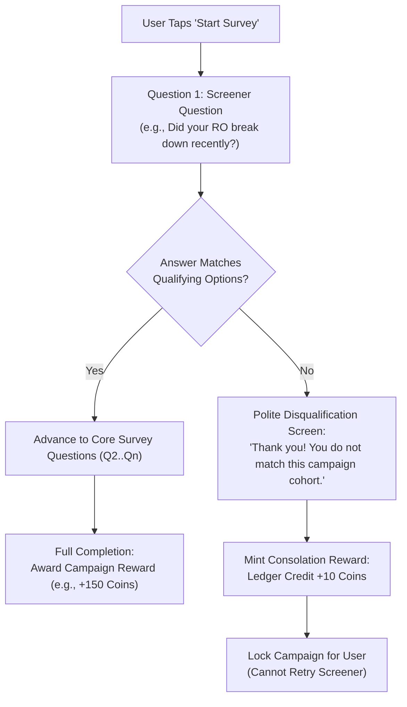

#### Disqualification Guarantees
1. **Transparent Consolation:** Per `GHARSURE_USER_ACTION_MAP.md` line 193: *"Thank you! You do not match this campaign's target cohort. 10 appreciation coins have been added to your wallet."*
2. **Immediate Ledger Commit:** The +10 Coin credit is committed via an atomic ledger transaction (`reference_type: 'SURVEY_SCREENER_DQ'`).
3. **Anti-Gaming Lockout:** Once a user is disqualified from a campaign, the session state transitions to `SCREENER_DISQUALIFIED`. The user cannot restart or re-screen for that specific campaign ID.
4. **Quota Protection:** Disqualified sessions do **NOT** increment the campaign's qualified response quota (`completed_count`).

---

## Section 10: Survey Details and Pre-Start Experience

`Status: PROPOSED`  
`Requirement ID: FORM-PRE-001`

Tapping an available survey card from the feed opens a slide-up modal sheet (or dedicated full-screen view) presenting the complete research brief before the resident commits time.

### 10.1 Survey Brief Layout Wireframe

```
┌────────────────────────────────────────────────────────┐
│ [X] Close                                     Share ↗  │
│                                                        │
│ [ Water & Filtration ]                                 │
│ Bangalore Monsoon Borewell Water Study                 │
│                                                        │
│ ┌──────────────┬──────────────┬──────────────────────┐ │
│ │ ⏱ 4 Mins     │ ❓ 6 Steps   │ 💰 +150 Coins        │ │
│ └──────────────┴──────────────┴──────────────────────┘ │
│                                                        │
│ 📖 Research Purpose:                                   │
│ GharSure Labs is analyzing how high-TDS monsoon runoff │
│ impacts RO membrane life across Bangalore apartments.  │
│                                                        │
│ 🛡 Privacy & Data Use:                                 │
│ • Responses are anonymized under the DPDP Act 2023.    │
│ • No personal contact info is shared with sponsors.    │
│ • Aggregated findings will update Building Scorecards. │
│                                                        │
│ ℹ️ Eligibility Note:                                  │
│ Early questions verify your current filter setup. If   │
│ your home is not a match, you'll still earn 10 Coins!  │
│                                                        │
│ [X] I consent to research data processing (DPDP Act)   │
│                                                        │
│ [             Start Survey (Earn +150)               ] │
└────────────────────────────────────────────────────────┘
```

### 10.2 Mandatory Pre-Start Disclosures
1. **Expected Time Commitment:** Conservative estimate based on question count and complexity.
2. **Question Count:** Explicit count (e.g., *6 Questions*).
3. **Reward Terms:** Explicit statement of the full reward (+150 Coins) vs. screener consolation reward (+10 Coins).
4. **Sponsor / Independence Transparency:** Clear disclosure of whether the survey is an independent GharSure study or commissioned by an authorized partner.
5. **Statutory DPDP Consent Checkbox:** Unchecked by default; required before the "Start Survey" CTA becomes active.
6. **Save & Resume Notice:** Informs the user that progress can be saved and resumed within 48 hours.

### 10.3 Pre-Start Race Condition Protection
If the campaign quota fills or the campaign is paused while a user is reading the pre-start sheet:
* When the user taps **"Start Survey"**, the backend validates quota in a transactional Redis check.
* If unavailable, the UI gracefully traps HTTP `409 Conflict` and presents a friendly dialog: *"This survey just reached its response limit! We've updated your feed with fresh studies."*

---

## Section 11: Question Types and Question Schema

`Status: EXISTING (Types cited in GHARSURE_USER_ACTION_MAP.md line 189) / PROPOSED (Canonical Schema)`  
`Requirement ID: FORM-QUES-001`

GharSure's question schema is strictly structured to enable automated validation, dynamic branching, and structured analytical aggregation.

### 11.1 Supported Question Types Matrix

| Question Type Code | Display Label | Mobile Input Control | Validation Capabilities | MVP Phase Status |
| :--- | :--- | :--- | :--- | :--- |
| `SINGLE_CHOICE` | Single Choice | Vertical radio button list; card chips. | Exactly 1 selection required. | `MVP` |
| `MULTIPLE_CHOICE`| Multiple Choice | Checkbox list with multi-select chips. | `min_select`, `max_select` bounds. | `MVP` |
| `SHORT_TEXT` | Short Text | Single-line input field with char counter.| `min_length`, `max_length`, regex. | `MVP` |
| `LONG_TEXT` | Long Text | Multi-line textarea (expandable). | `max_length` (e.g., 500 chars). | `MVP` |
| `NUMERIC_INPUT` | Numeric Value | Number keypad; supports prefix/suffix. | `min_val`, `max_val`, integer/float. | `MVP` |
| `RATING_SCALE` | Rating Scale | 1 to 5 stars or numeric horizontal scale.| Range bounds ($1..5$ or $1..10$). | `MVP` |
| `LIKERT_SCALE` | Likert Scale | 5-point agreement scale (Disagree..Agree)| Standardized 1–5 ordinal codes. | `MVP` |
| `YES_NO` | Yes / No | Dual toggle buttons / segmented chip. | Boolean `true`/`false`. | `MVP` |
| `DROPDOWN` | Dropdown Select | Searchable modal bottom sheet picker. | Exact match against option list. | `MVP` |
| `IMAGE_UPLOAD` | Photo Upload | Native camera capture or gallery picker. | File size $\le 5$MB; JPEG/PNG; EXIF scrub.| `MVP` (Restricted) |
| `DATE_PICKER` | Date Selection | Native OS calendar wheel / picker. | `min_date`, `max_date` (no future dates).| `POST_MVP` |
| `RANKING` | Rank Order | Drag-and-drop reorderable list. | Complete ordering of items. | `DEFERRED` |

### 11.2 Canonical Question Schema (JSON Schema Definition)

```json
{
  "$schema": "http://json-schema.org/draft-07/schema#",
  "title": "GharSureSurveyQuestion",
  "type": "object",
  "required": [
    "question_id",
    "order_index",
    "question_type",
    "question_text",
    "is_required"
  ],
  "properties": {
    "question_id": { "type": "string", "format": "uuid" },
    "order_index": { "type": "integer", "minimum": 1 },
    "question_type": {
      "type": "string",
      "enum": [
        "SINGLE_CHOICE",
        "MULTIPLE_CHOICE",
        "SHORT_TEXT",
        "LONG_TEXT",
        "NUMERIC_INPUT",
        "RATING_SCALE",
        "LIKERT_SCALE",
        "YES_NO",
        "DROPDOWN",
        "IMAGE_UPLOAD"
      ]
    },
    "question_text": { "type": "string", "minLength": 5, "maxLength": 250 },
    "help_text": { "type": "string", "maxLength": 200 },
    "is_required": { "type": "boolean", "default": true },
    "is_screener": { "type": "boolean", "default": false },
    "options": {
      "type": "array",
      "items": {
        "type": "object",
        "required": ["option_id", "label", "value"],
        "properties": {
          "option_id": { "type": "string" },
          "label": { "type": "string" },
          "value": { "type": "string" },
          "is_qualifying": { "type": "boolean", "default": true }
        }
      }
    },
    "validation": {
      "type": "object",
      "properties": {
        "min_numeric": { "type": "number" },
        "max_numeric": { "type": "number" },
        "min_selections": { "type": "integer" },
        "max_selections": { "type": "integer" },
        "regex_pattern": { "type": "string" },
        "unit_suffix": { "type": "string" }
      }
    },
    "conditional_visibility": {
      "type": "object",
      "properties": {
        "depends_on_question_id": { "type": "string", "format": "uuid" },
        "operator": { "type": "string", "enum": ["EQUALS", "IN", "GREATER_THAN"] },
        "expected_value": {}
      }
    }
  }
}
```

---

## Section 12: Question Flow, Branching, and Validation

`Status: PROPOSED`  
`Requirement ID: FORM-FLOW-001`

### 12.1 Presentation UX Pattern: Single-Question Stepper
GharSure adopts a **Single-Question-Per-Screen Stepper Pattern** for mobile devices (aligning with `GHARSURE_USER_ACTION_MAP.md` line 188).
* **Rationale:** Reduces visual friction, eliminates endless vertical keyboard jumping, and ensures thumb-friendly touch targets on mobile viewports.
* **Header Controls:** Contains a persistent top linear progress bar (e.g., `Step 3 of 6`), Back button (`<`), and a top-right **"Save & Exit"** touch icon.

```
┌────────────────────────────────────────────────────────┐
│ [< Back]        [========        ] 3/6     [Save & Exit]│
│                                                        │
│ How often do you service your RO Water Purifier?       │
│ Select the interval that best matches your routine.    │
│                                                        │
│ ┌────────────────────────────────────────────────────┐ │
│ │ ( ) Every 3 to 4 Months (Frequent)                 │ │
│ ├────────────────────────────────────────────────────┤ │
│ │ (•) Every 6 Months (Standard)                      │ │
│ ├────────────────────────────────────────────────────┤ │
│ │ ( ) Once a Year (Annual AMC)                       │ │
│ ├────────────────────────────────────────────────────┤ │
│ │ ( ) Only when water taste changes or filter beeps  │ │
│ └────────────────────────────────────────────────────┘ │
│                                                        │
│ [              Next Question  ( -> )                 ] │
└────────────────────────────────────────────────────────┘
```

### 12.2 Directed Acyclic Graph (DAG) Branching Rules
Branching logic determines the dynamic path of questions. The survey engine treats questions as vertices in a DAG:
1. **Rule Structure:** Each question or option can define a destination pointer:
   $$\text{IF Answer}(Q_k) = V_j \implies \text{GOTO } Q_{\text{dest}}$$
2. **Cycle Prevention:** Admin pre-publish validation runs a Depth-First Search (DFS) topological sort. Any detected cycle aborts publication with a descriptive error.
3. **Dead-End Detection:** Every branch must either resolve to a subsequent valid question or to the standard terminal node: `SUBMIT_SURVEY`.

### 12.3 Backtracking and Stale Answer Invalidation
When a resident taps the **"Back"** button and changes an answer that previously governed downstream conditional branching:
* **Strict Invalidation Rule:** Any downstream questions that become conditionally hidden due to the answer modification have their existing answers **soft-cleared** (`is_active: false`).
* **Audit Trail Preservation:** Stale answers remain in the database marked as `REVOKED_BY_BRANCH_CHANGE` for analytical auditability, but are excluded from final submission payloads and scoring models.

### 12.4 Two-Tier Validation Architecture
1. **Client-Side (Usability Tier):** Immediate haptic feedback and inline warning messages if required inputs are empty, numbers exceed bounds, or regex fails.
2. **Server-Side (Security & Enforcement Tier):** Every answer payload sent to the backend is re-validated against the canonical schema, active branching path, and data bounds. Client validations can never bypass server-side rules.

---

## Section 13: Progress, Saving, and Session Management

`Status: EXISTING (48h Save & Exit in GHARSURE_USER_ACTION_MAP.md line 190) / PROPOSED (Session Protocol)`  
`Requirement ID: FORM-SESS-001`

To prevent data loss and support busy apartment residents answering surveys between daily chores, GharSure supports robust session management.

### 13.1 Survey Session Lifecycle State Machine

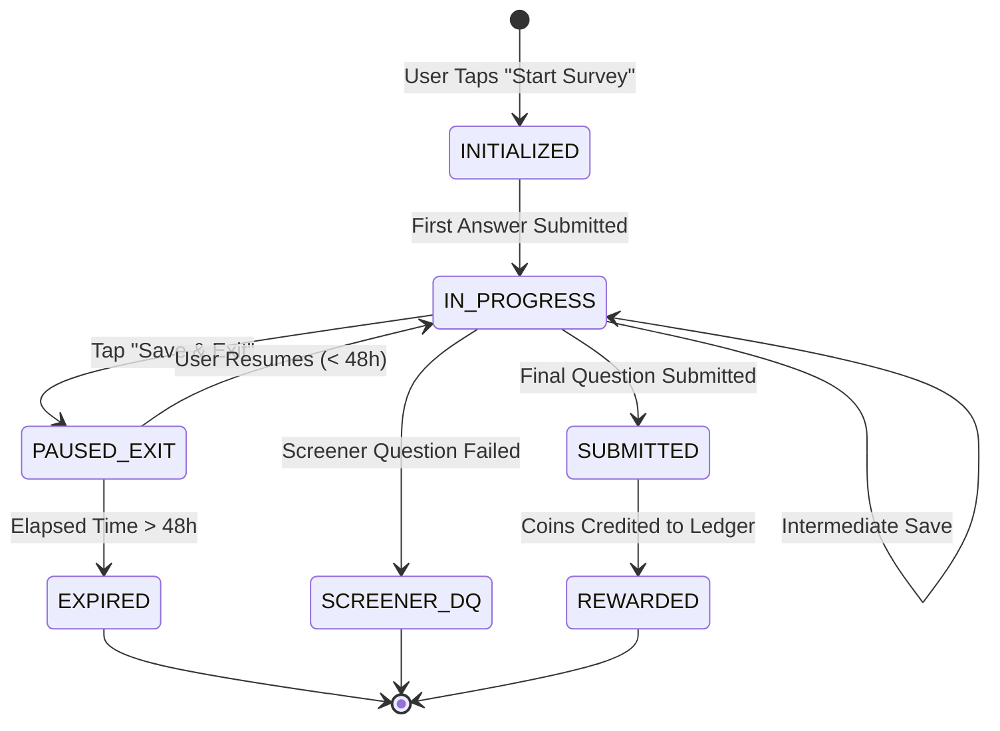

### 13.2 Session Protocol and Persistence Rules
1. **Session Creation:** When a user initiates a survey, the backend generates an immutable `session_id` (`UUIDv4`) and creates a record in `survey_sessions` linked to `user_id` and `survey_version_id`.
2. **48-Hour Save & Resume Guarantee:**
   * Per `GHARSURE_USER_ACTION_MAP.md` line 190, tapping **"Save & Exit"** persists all answered questions to the server.
   * The session enters `PAUSED_EXIT` status. A Redis TTL key is registered: `session:ttl:{session_id}` set to $172,800$ seconds (48 hours).
   * In Tab 2, the survey card transforms to: **"Continue Survey (Q3/6)"**.
3. **Session Expiration:** If the session is not resumed within 48 hours, a background cleanup worker transitions the state to `EXPIRED`. The session cannot be resumed.
4. **Offline Resiliency & State Hydration:**
   * Mobile clients maintain an encrypted local SQLite draft store.
   * If a network drop occurs mid-survey, answers queue locally. The runner displays a subtle banner: `Offline - Changes will sync when reconnected`.
5. **Single Active Device Policy:** If a user logs into a second device and attempts to open an active survey session, the backend checks session tokens. A prompt informs the user: *"Session active on another device. Resume here?"* Proceeding revokes the previous device's write token.
6. **Submission Idempotency:** The final submission API call requires a client-generated `idempotency_key` (`UUIDv4`). Duplicate network retries or frantic double-taps return the cached HTTP `200` response without duplicating coin ledger credits.

---

## Section 14: Reward Configuration and Issuance

`Status: EXISTING (Coins & Ledger in GHARSURE_USER_ACTION_MAP.md line 179) / PROPOSED (Issuance Engine)`  
`Requirement ID: FORM-REWARD-001`

Rewards represent a sacred trust between GharSure and its resident community. Reward processing must be server-authoritative, strictly idempotent, and auditable.

### 14.1 Supported Reward Modalities

| Reward Type | Technical Value | Triggering Condition | Ledger Transaction Type | User Notification | Status |
| :--- | :--- | :--- | :--- | :--- | :--- |
| **GharSure Coins (Full)**| Integer (e.g., `+150`) | Full, qualified survey submission. | `SURVEY_COMPLETION_CREDIT` | Confetti modal + Push alert | `EXISTING` |
| **GharSure Coins (DQ)** | Integer (`+10`) | Screener disqualification. | `SURVEY_SCREENER_DQ_CREDIT`| Polite modal + Balance update | `EXISTING` |
| **Product Trial Voucher**| Single-use Coupon Code| Milestone / Special research study. | `TRIAL_ENTITLEMENT_GRANT` | Unmasked code in Coupon Wallet | `EXISTING` |
| **Brand Discount Code** | Alphanumeric Promo Code| Optional secondary incentive. | `VOUCHER_CLAIM_GRANT` | Saved to Coupon Wallet | `EXISTING` |
| **No Commercial Reward** | `0` Coins | Internal society observation poll.| None | Thank-you confirmation | `PROPOSED` |

### 14.2 Server-Authoritative Ledger Integration

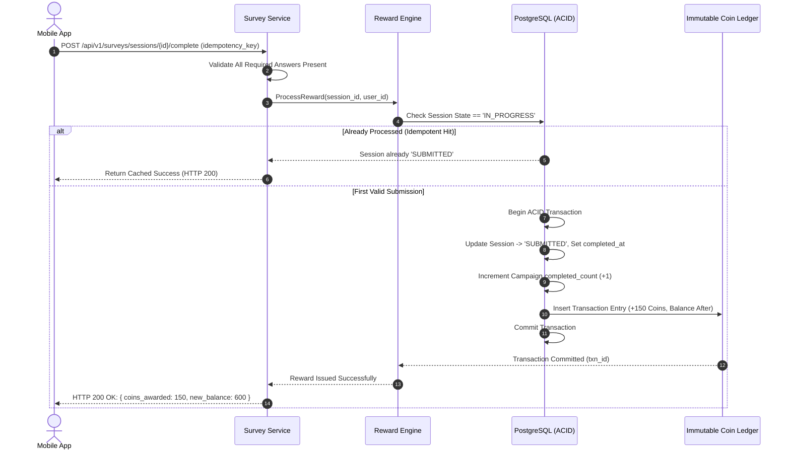

### 14.3 Ledger Integrity Invariants
1. **Double-Credit Prevention:** Under no race condition can a single `session_id` produce more than one coin ledger entry. Enforced via a `UNIQUE` database constraint on `reward_ledger(reference_id) WHERE reference_type = 'SURVEY_COMPLETION'`.
2. **Decoupling Completion from External Redemption:**
   * Survey completion is confirmed immediately upon valid submission.
   * External partner voucher redemption occurs on the third-party merchant site; GharSure records voucher *issuance* immediately, but marks *redemption* only upon receiving verified partner telemetry or explicit resident confirmation.

---

## Section 15: Admin Survey Builder

`Status: PROPOSED`  
`Requirement ID: FORM-ADMIN-001`

The Admin Survey Builder provides GharSure Research Operations with a web-based, desktop-optimized control center.

### 15.1 15-Step End-to-End Administrative Workflow

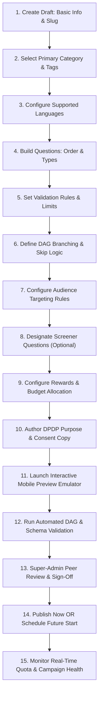

### 15.2 Step-by-Step Administrative Requirements

| Step | Workflow Stage | Admin Configuration Actions & Capabilities | Automated System Validation |
| :--- | :--- | :--- | :--- |
| **01** | **Draft Creation** | Input survey internal name, consumer title, short description, cover URL. | Title length 5..100; unique slug generation. |
| **02** | **Category & Tags** | Select 1 primary category from standard taxonomy; add up to 5 tags. | Category must exist in `lookup_categories`. |
| **03** | **Languages** | Define default language (`'en'`) and optional local translations (`'hi'`, `'kn'`). | At least 1 language specified. |
| **04** | **Questions** | Add, edit, delete, and drag-and-drop reorder questions. | Question text not empty; options have unique keys. |
| **05** | **Validation Rules** | Configure required flags, numeric ranges, text lengths, and regex. | Bounds mathematically coherent ($\min \le \max$). |
| **06** | **Branching Logic** | Add conditional jumps (e.g., `IF Q2 == 'Borewell' GOTO Q4`). | DFS cycle detection; no orphaned questions. |
| **07** | **Targeting** | Configure demographic, geographic, and appliance rules (AND/OR). | Target query resolves to $\ge 50$ users. |
| **08** | **Screeners** | Mark Q1 as screener; select qualifying vs. disqualifying options. | Consolation reward fixed to 10 Coins. |
| **09** | **Rewards & Budget**| Set completion coins, target quota, and total coin budget cap. | $\text{Budget} \ge \text{Quota} \times \text{Coins}$. Treasury balance checked.|
| **10** | **Privacy & Consent**| Review DPDP purpose disclosure and data retention parameters. | Mandatory consent checkbox text verified. |
| **11** | **Preview Emulator**| Run interactive mobile device simulator; test all branching paths. | None (visual testing). |
| **12** | **Pre-Publish Check**| Trigger comprehensive system pre-flight validation. | Complete validation suite passes (Section 2.2). |
| **13** | **Approval Gate** | Submit to Research Super-Admin for dual-custody verification. | Approver user ID $\ne$ author user ID. |
| **14** | **Publish/Schedule**| Set execution to `IMMEDIATE` or provide future `start_time`. | Start time valid; state transitions to `PUBLISHED`. |
| **15** | **Live Monitoring** | Real-time response velocity charts, drop-off heatmap, quota tracker. | Auto-close triggers armed (Quota / Date / Budget).|

### 15.3 Role-Based Access Control (RBAC) Permissions
* **Research Analyst:** Can draft surveys, view analytics, and run preview emulators. Cannot publish, edit live campaigns, or export unmasked datasets.
* **Campaign Manager:** Can create, edit, schedule, and pause campaigns within their assigned categories.
* **Super Admin:** Full rights; required for dual-custody approval of campaigns exceeding 10,000 Coins in budget; can trigger manual force-closure and archive campaigns.

---

## Section 16: Versioning and Campaign Management

`Status: PROPOSED`  
`Requirement ID: FORM-VERS-001`

### 16.1 Immutability of Published Survey Versions
To protect scientific integrity and legal consent, **a published survey version is strictly immutable**.
* Once a survey moves to `PUBLISHED`, its core content (question texts, order, options, branching logic, reward amounts, and consent wording) is permanently locked.
* **Minor Edits:** Fixing non-substantive typos or updating cosmetic cover images is permitted on a live version without re-versioning, provided no semantic meaning is altered.
* **Major Edits:** Modifying question options, adding/removing questions, changing coin rewards, or modifying targeting rules requires creating a **New Version** (e.g., `v1.0.0` $\rightarrow$ `v2.0.0`).

### 16.2 In-Flight Session Version Pinning
When a new version (`v2.0.0`) is published while an older version (`v1.0.0`) is actively running:
* **Existing Sessions:** All sessions currently in `IN_PROGRESS` or `PAUSED_EXIT` remain pinned to `v1.0.0`. They complete the survey exactly as authored when they began.
* **New Sessions:** Any resident tapping "Start Survey" after the publication timestamp is initialized under `v2.0.0`.
* **Database Representation:** `survey_sessions` maintains a foreign key to `survey_versions(version_id)`, guaranteeing zero cross-version schema bleeding.

### 16.3 Automated Campaign Closure Engine
A background cron worker evaluates campaign termination conditions every 60 seconds:

$$\text{Trigger Close IF } (\text{NOW}() \ge \text{end\_time}) \lor (\text{completed\_count} \ge \text{quota\_limit}) \lor (\text{spent\_coins} \ge \text{budget\_limit})$$

* Upon triggering, campaign status shifts from `PUBLISHED` to `CLOSED`.
* `close_reason` is stamped (`'SCHEDULED_EXPIRY'`, `'QUOTA_REACHED'`, or `'BUDGET_EXHAUSTED'`).
* Redis cache is invalidated; mobile feeds drop the card on subsequent requests.

---

## Section 17: Data Model and Relationships

`Status: PROPOSED (Architectural Schema Design)`  
`Requirement ID: FORM-DATA-001`

The relational database architecture is normalized for operational speed, relational integrity, and statutory DPDP compliance.

### 17.1 Entity-Relationship Diagram

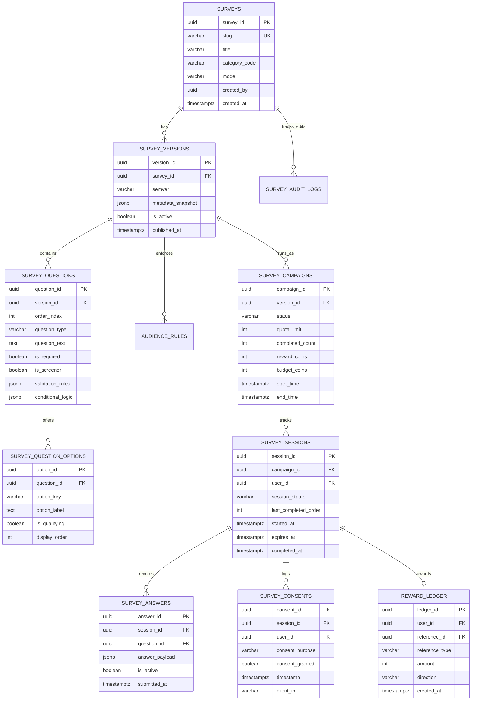

### 17.2 Detailed Database Table Specifications

#### Table 1: `surveys`
* `survey_id` (`UUIDv4`, PK): Unique global survey identifier.
* `slug` (`VARCHAR(120)`, UNIQUE, NOT NULL): URL-safe readable slug.
* `title` (`VARCHAR(150)`, NOT NULL): Primary consumer title.
* `category_code` (`VARCHAR(50)`, NOT NULL, FK $\rightarrow$ `lookup_categories.code`): Primary category.
* `mode` (`VARCHAR(20)`, NOT NULL, DEFAULT `'FORM'`): Survey presentation mode (`'FORM'`, `'AI_TEXT'`, `'AI_VOICE'`).
* `cover_image_url` (`VARCHAR(512)`, NOT NULL): CDN URL for thumbnail.
* `internal_objective` (`TEXT`, NOT NULL): Confidential research hypothesis.
* `created_by` (`UUIDv4`, NOT NULL, FK $\rightarrow$ `admin_users.id`): Author ID.
* `created_at` (`TIMESTAMPTZ`, NOT NULL, DEFAULT `NOW()`): Creation timestamp.

#### Table 2: `survey_versions`
* `version_id` (`UUIDv4`, PK): Version identifier.
* `survey_id` (`UUIDv4`, NOT NULL, FK $\rightarrow$ `surveys.survey_id` ON DELETE CASCADE).
* `semver` (`VARCHAR(10)`, NOT NULL): Semantic version string (e.g., `'1.0.0'`).
* `metadata_snapshot` (`JSONB`, NOT NULL): Complete frozen snapshot of survey metadata at publish time.
* `is_active` (`BOOLEAN`, NOT NULL, DEFAULT `false`): Flag for currently active version.
* `published_at` (`TIMESTAMPTZ`): Timestamp of formal publication.

#### Table 3: `survey_questions`
* `question_id` (`UUIDv4`, PK): Question identifier.
* `version_id` (`UUIDv4`, NOT NULL, FK $\rightarrow$ `survey_versions.version_id` ON DELETE CASCADE).
* `order_index` (`INT`, NOT NULL): Step number in flow (1-indexed).
* `question_type` (`VARCHAR(30)`, NOT NULL): One of 10 standard types (Section 11).
* `question_text` (`TEXT`, NOT NULL): Full question string presented to user.
* `help_text` (`TEXT`): Subtitle or operational instruction.
* `is_required` (`BOOLEAN`, NOT NULL, DEFAULT `true`): Mandatory answer flag.
* `is_screener` (`BOOLEAN`, NOT NULL, DEFAULT `false`): Screener question flag.
* `validation_rules` (`JSONB`): Bounds, regex, min/max selection rules.
* `conditional_logic` (`JSONB`): Directed branch conditions.

#### Table 4: `survey_campaigns`
* `campaign_id` (`UUIDv4`, PK): Campaign runtime identifier.
* `version_id` (`UUIDv4`, NOT NULL, FK $\rightarrow$ `survey_versions.version_id`).
* `status` (`VARCHAR(30)`, NOT NULL, DEFAULT `'DRAFT'`): Lifecycle state.
* `quota_limit` (`INT`, NOT NULL, DEFAULT `500`): Max qualified responses.
* `completed_count` (`INT`, NOT NULL, DEFAULT `0`): Running total of completions.
* `reward_coins` (`INT`, NOT NULL, DEFAULT `150`): Coins awarded for completion.
* `budget_coins` (`INT`, NOT NULL): Total coin budget allocated.
* `start_time` (`TIMESTAMPTZ`, NOT NULL): Scheduled activation time.
* `end_time` (`TIMESTAMPTZ`, NOT NULL): Scheduled closure time.
* `close_reason` (`VARCHAR(50)`): Closure trigger reason.

#### Table 5: `survey_sessions`
* `session_id` (`UUIDv4`, PK): Session runtime identifier.
* `campaign_id` (`UUIDv4`, NOT NULL, FK $\rightarrow$ `survey_campaigns.campaign_id`).
* `user_id` (`UUIDv4`, NOT NULL, FK $\rightarrow$ `users.id`): Participant user ID.
* `session_status` (`VARCHAR(30)`, NOT NULL, DEFAULT `'INITIALIZED'`): Lifecycle state.
* `last_completed_order` (`INT`, NOT NULL, DEFAULT `0`): Last completed step index.
* `started_at` (`TIMESTAMPTZ`, NOT NULL, DEFAULT `NOW()`): Session initiation.
* `expires_at` (`TIMESTAMPTZ`, NOT NULL): Expiry time ($172,800$ seconds from start).
* `completed_at` (`TIMESTAMPTZ`): Timestamp of submission or disqualification.
* *Constraints:* `UNIQUE(campaign_id, user_id)` (One session per user per campaign).

#### Table 6: `survey_answers`
* `answer_id` (`UUIDv4`, PK): Answer record identifier.
* `session_id` (`UUIDv4`, NOT NULL, FK $\rightarrow$ `survey_sessions.session_id` ON DELETE CASCADE).
* `question_id` (`UUIDv4`, NOT NULL, FK $\rightarrow$ `survey_questions.question_id`).
* `answer_payload` (`JSONB`, NOT NULL): Structured answer value (e.g., `{"selected_option": "OPT_01"}` or `{"numeric_val": 450}`).
* `is_active` (`BOOLEAN`, NOT NULL, DEFAULT `true`): Active flag (soft-cleared if branch changes).
* `submitted_at` (`TIMESTAMPTZ`, NOT NULL, DEFAULT `NOW()`): Submission timestamp.

#### Table 7: `survey_consents`
* `consent_id` (`UUIDv4`, PK): Statutory consent log identifier.
* `session_id` (`UUIDv4`, NOT NULL, FK $\rightarrow$ `survey_sessions.session_id`).
* `user_id` (`UUIDv4`, NOT NULL, FK $\rightarrow$ `users.id`).
* `consent_purpose` (`VARCHAR(150)`, NOT NULL): Explicit legal purpose string.
* `consent_granted` (`BOOLEAN`, NOT NULL, DEFAULT `true`): Acceptance flag.
* `timestamp` (`TIMESTAMPTZ`, NOT NULL, DEFAULT `NOW()`): Cryptographic timestamp.
* `client_ip` (`VARCHAR(45)`, NOT NULL): Pseudonymized client IP hash.

---

## Section 18: API Contracts and Backend Behavior

`Status: PROPOSED`  
`Requirement ID: FORM-API-001`

All endpoints conform to GharSure RESTful standards: rooted at `/api/v1`, using JSON request/response bodies, standard HTTP status codes, and JWT Bearer token authentication.

### 18.1 Consumer API Endpoints Matrix

| HTTP Method | Route Endpoint | Authentication | Rate Limit | Purpose & Operation |
| :--- | :--- | :--- | :--- | :--- |
| `GET` | `/api/v1/surveys/feed` | Bearer (User) | 60 req/min | Fetch eligible, ranked surveys for active user feed. |
| `GET` | `/api/v1/surveys/{id}` | Bearer (User) | 60 req/min | Fetch pre-start details and metadata for a specific survey. |
| `POST` | `/api/v1/surveys/{id}/start` | Bearer (User) | 20 req/min | Initialize a new session; returns `session_id` & Q1. |
| `GET` | `/api/v1/surveys/sessions/{id}`| Bearer (User) | 60 req/min | Resume saved progress; returns answers & next question. |
| `POST` | `/api/v1/surveys/sessions/{id}/answer` | Bearer (User) | 120 req/min| Submit single answer; evaluates DAG; returns next Q or DQ. |
| `POST` | `/api/v1/surveys/sessions/{id}/complete` | Bearer (User) | 10 req/min | Final submission; triggers coin ledger transaction. |

### 18.2 Detailed Endpoint Specifications (Samples)

#### 1. Start Survey Session: `POST /api/v1/surveys/{id}/start`
* **Request Headers:**
  * `Authorization: Bearer <JWT>`
  * `X-Client-Version: 2.4.0`
* **Request Body:**
  ```json
  {
    "consent_granted": true,
    "consent_purpose": "GHARSURE_HOUSEHOLD_RESEARCH_DPDP_2026"
  }
  ```
* **Success Response (`201 Created`):**
  ```json
  {
    "status": "SUCCESS",
    "data": {
      "session_id": "9b1deb4d-3b7d-4bad-9bdd-2b0d7b3dcb6d",
      "survey_id": "f47ac10b-58cc-4372-a567-0e02b2c3d479",
      "version": "1.0.0",
      "expires_at": "2026-10-21T11:30:00Z",
      "total_steps": 6,
      "current_step": 1,
      "first_question": {
        "question_id": "c9a646d3-9c61-4cc9-bc18-4702162a0487",
        "question_type": "SINGLE_CHOICE",
        "is_screener": true,
        "question_text": "What is the primary source of water in your flat?",
        "options": [
          { "option_id": "OPT_1", "label": "Borewell Water", "value": "BOREWELL" },
          { "option_id": "OPT_2", "label": "Cauvery / Municipal", "value": "MUNICIPAL" },
          { "option_id": "OPT_3", "label": "Private Water Tanker", "value": "TANKER" }
        ]
      }
    }
  }
  ```
* **Error Response (`409 Conflict` - Quota Met / Already Completed):**
  ```json
  {
    "error": {
      "code": "CAMPAIGN_QUOTA_EXHAUSTED",
      "message": "This survey has reached its maximum participation limit.",
      "timestamp": "2026-10-19T11:30:00Z"
    }
  }
  ```

#### 2. Submit Question Answer: `POST /api/v1/surveys/sessions/{id}/answer`
* **Request Body:**
  ```json
  {
    "question_id": "c9a646d3-9c61-4cc9-bc18-4702162a0487",
    "answer_payload": {
      "selected_option_id": "OPT_1",
      "value": "BOREWELL"
    }
  }
  ```
* **Success Response (Branching to Next Question):**
  ```json
  {
    "status": "SUCCESS",
    "data": {
      "session_status": "IN_PROGRESS",
      "completed_step": 1,
      "total_steps": 6,
      "next_question": {
        "question_id": "e3b0c442-98fc-1c14-9afbf4c8996fb924",
        "question_type": "NUMERIC_INPUT",
        "question_text": "What is your measured drinking water TDS (in ppm)?",
        "validation": { "min_numeric": 10, "max_numeric": 3000, "unit_suffix": "ppm" }
      }
    }
  }
  ```
* **Screener Disqualification Response (`200 OK`):**
  ```json
  {
    "status": "DISQUALIFIED",
    "data": {
      "session_status": "SCREENER_DISQUALIFIED",
      "consolation_reward": {
        "coins_awarded": 10,
        "ledger_transaction_id": "tx_dq_8849102",
        "message": "Thank you! You do not match this campaign's target cohort. 10 appreciation coins have been added to your wallet."
      }
    }
  }
  ```

#### 3. Complete Survey: `POST /api/v1/surveys/sessions/{id}/complete`
* **Request Headers:**
  * `Idempotency-Key: 7f8a9e2d-3c4b-5a6f-7e8d-9c0b1a2f3e4d`
* **Success Response (`200 OK`):**
  ```json
  {
    "status": "SUCCESS",
    "data": {
      "session_status": "SUBMITTED",
      "completed_at": "2026-10-19T11:35:12Z",
      "reward": {
        "reward_type": "GHARSURE_COINS",
        "coins_credited": 150,
        "new_wallet_balance": 600,
        "ledger_transaction_id": "tx_comp_9920141"
      }
    }
  }
  ```

---

## Section 19: Privacy, Security, and Access Control

`Status: EXISTING (DPDP Principles in GHARSURE_USER_ACTION_MAP.md line 409) / PROPOSED (Detailed Security Controls)`  
`Requirement ID: FORM-PRIV-001`

GharSure handles intimate household details (appliances owned, water quality, maintenance expenses). Strict technical safeguards are non-negotiable.

### 19.1 Statutory DPDP Act 2023 Compliance
1. **Purpose Limitation:** Survey data is collected exclusively for household research and product quality benchmarking. Answers cannot be repurpose-marketed without fresh consent.
2. **Explicit Consent Ledger:** Every participant's pre-start consent acceptance is recorded in `survey_consents` alongside an immutable cryptographic timestamp and client hash.
3. **Right to Erasure (Withdrawal of Consent):**
   * If a resident requests account deletion via the Profile Drawer (`GHARSURE_USER_ACTION_MAP.md` line 411), their survey answers undergo **irreversible de-identification**.
   * Personal identifiers (`user_id`, `session_id`, `client_ip`) are purged/nulled. Anonymized answer tuples are retained strictly for statistical aggregate validity.

### 19.2 Sponsor and Partner Data Isolation
* **Zero Raw Data Access:** Brand sponsors, research clients, and commercial partners **NEVER** receive access to raw, row-level survey response records.
* **k-Anonymity Reporting Guarantee:** Analytics exports and sponsor dashboards enforce a strict threshold of $k \ge 10$. If an aggregated query (e.g., *Prestige Falcon City $\rightarrow$ Tower 4 $\rightarrow$ RO Purifier Breakdowns*) returns fewer than 10 respondents, the cell is suppressed with a notice: `Data suppressed to protect resident anonymity`.
* **Zero Commercial PII Export:** Resident names, phone numbers, flat/door numbers, and email addresses are cryptographically excluded from all analytical pipelines and reporting views.

### 19.3 Image and Upload Security Controls
For questions utilizing the `IMAGE_UPLOAD` type (e.g., photographing a water filter cartridge or TDS meter screen):
1. **EXIF Metadata Sanitization:** The server pipeline immediately strips all Exchangeable Image File (EXIF) metadata—specifically GPS coordinates, device serial numbers, and camera timestamps—before persisting the image.
2. **Virus & Malware Scanning:** Uploaded binary streams pass through an asynchronous ClamAV / Cloud Scanner buffer before being written to private AWS S3 / Cloud Storage buckets.
3. **Storage Security:** Images are stored with randomized UUID keys in non-public buckets. Access is restricted to short-lived pre-signed URLs (15-minute TTL) issued exclusively to authorized admin auditors.

---

## Section 20: Analytics and Reporting

`Status: PROPOSED`  
`Requirement ID: FORM-ANAL-001`

To measure campaign health and detect survey friction, the platform captures high-resolution operational and analytical telemetry.

### 20.1 Core Operational Metrics

| Metric Name | Calculation Formula | Technical Source | Target Operational Benchmark |
| :--- | :--- | :--- | :--- |
| **Card Impression Rate** | $\text{Count}(\text{Card Render Events})$ | Mobile Feed Telemetry | N/A (Volume indicator) |
| **Detail Click-Through Rate** | $\frac{\text{Detail Sheet Opens}}{\text{Card Impressions}} \times 100$ | Mobile Analytics | $\ge 18\%$ |
| **Survey Start Rate** | $\frac{\text{Sessions Initialized}}{\text{Detail Sheet Opens}} \times 100$ | Server API Logs | $\ge 65\%$ |
| **Screener Pass Rate** | $\frac{\text{Passed Step 1}}{\text{Sessions Initialized}} \times 100$ | Session State Store | $40\% - 75\%$ (Campaign-dependent) |
| **Full Completion Rate** | $\frac{\text{Sessions Submitted}}{\text{Sessions Passed Screener}} \times 100$| Session State Store | $\ge 82\%$ |
| **Drop-Off by Question** | $\frac{\text{Abandonments at Step } k}{\text{Impressions at Step } k} \times 100$ | Answer Event Telemetry | $\le 5\%$ per step (Steps $2..n$) |
| **Median Completion Time** | Median of $(\text{completed\_at} - \text{started\_at})$ | Session Table Timestamps | Within $\pm 20\%$ of estimate |
| **Reward Delivery Latency** | $99^{\text{th}}$ percentile of $(\text{Ledger Time} - \text{Submit Time})$| Ledger Telemetry | $< 500\text{ ms}$ |

### 20.2 Standard Analytics Event Taxonomy

Every event is dispatched with standard mobile envelope properties: `user_id` (pseudonymized), `session_id`, `survey_id`, `version_id`, `app_version`, `device_os`, `timestamp`.

```json
[
  {
    "event_name": "survey_card_impression",
    "properties": { "survey_id": "UUID", "category": "WATER_FILTRATION", "recommendation_reason": "RO_PURIFIER_OWNER" }
  },
  {
    "event_name": "survey_detail_viewed",
    "properties": { "survey_id": "UUID", "source": "FEED_CARD" }
  },
  {
    "event_name": "survey_session_started",
    "properties": { "survey_id": "UUID", "session_id": "UUID" }
  },
  {
    "event_name": "survey_question_answered",
    "properties": { "session_id": "UUID", "question_id": "UUID", "step_index": 2, "time_spent_ms": 4200 }
  },
  {
    "event_name": "survey_screener_disqualified",
    "properties": { "session_id": "UUID", "failed_question_id": "UUID", "consolation_coins": 10 }
  },
  {
    "event_name": "survey_draft_saved",
    "properties": { "session_id": "UUID", "saved_at_step": 3 }
  },
  {
    "event_name": "survey_submitted_successfully",
    "properties": { "session_id": "UUID", "total_time_seconds": 184, "coins_awarded": 150 }
  }
]
```

---

## Section 21: Notifications and Reminders

`Status: EXISTING (Channel Switches & Quiet Hours in GHARSURE_USER_ACTION_MAP.md line 418) / PROPOSED (Survey Trigger Rules)`  
`Requirement ID: FORM-NOTIF-001`

Surveys leverage GharSure's centralized notification engine across **Push Notifications**, **SMS**, and **WhatsApp**.

### 21.1 Notification Matrix & Trigger Rules

| Notification Type | Trigger Event | Default Channel | Deep Link URI | Message Copy Template |
| :--- | :--- | :--- | :--- | :--- |
| **New Eligible Survey** | High-relevance survey published (Score $\ge 0.85$). | Push Notification | `gharsure://surveys/{id}` | *"New Study: Share your RO purifier feedback & earn 150 Coins!"* |
| **Save & Resume Reminder**| 24 hours elapsed since "Save & Exit" on active draft. | Push Notification | `gharsure://surveys/resume/{session_id}` | *"Don't lose your 150 Coins! Your survey is saved at Step 3 of 6. Tap to finish."* |
| **Closing Soon Alert** | 6 hours before campaign closes (if user eligible). | Push Notification | `gharsure://surveys/{id}` | *"Ending Tonight: Bangalore Water Study is closing soon. Earn your reward before spots fill!"* |
| **Reward Confirmation** | Successful survey submission & ledger commit. | In-App Toast & Inbox | `gharsure://wallet/ledger` | *"Boom! 150 GharSure Coins credited to your wallet. Balance: 600 Coins."* |

### 21.2 Operational Notification Guardrails
1. **Strict Quiet Hours:** Per `GHARSURE_USER_ACTION_MAP.md` line 418, **no notifications are ever dispatched between 9:00 PM and 8:00 AM IST**. Messages queued during quiet hours are delayed until 8:15 AM IST.
2. **Frequency Capping:** A resident can receive at most **one survey-related push notification per 48 hours** to avoid notification fatigue.
3. **Dead-Survey Suppression:** Before transmitting any push notification, the worker queries Redis to confirm the survey is still `PUBLISHED` and quota remains. If the campaign closed, the notification job is aborted immediately.

---

## Section 22: QA and Acceptance Criteria

`Status: PROPOSED`  
`Requirement ID: FORM-QA-001`

The survey engine must satisfy sixteen comprehensive, deterministic end-to-end test scenarios prior to production deployment.

### 22.1 Comprehensive QA Test Scenarios Matrix

| Test ID | Test Scenario Focus | Preconditions | Test Execution Steps | Expected Outcome | Priority |
| :--- | :--- | :--- | :--- | :--- | :--- |
| `TC-SURV-001` | Pre-Publish DAG Cycle Detection | Survey in `DRAFT`. | Admin configures: $Q_1 \rightarrow Q_2 \rightarrow Q_3 \rightarrow Q_1$. Taps "Validate". | Validation fails; specific error flags circular dependency ($Q_3 \rightarrow Q_1$). | `P0` |
| `TC-SURV-002` | Screener Disqualification Flow | Published survey with Q1 screener. | User selects disqualifying option on Q1. Submits answer. | Polite DQ modal appears; +10 Coins credited; campaign locked for user. | `P0` |
| `TC-SURV-003` | Happy Path Completion & Reward | Eligible user; published survey. | User answers all 6 questions validly; taps "Submit". | Confetti modal appears; +150 Coins credited in ledger; session marked `SUBMITTED`. | `P0` |
| `TC-SURV-004` | 48-Hour Save & Resume | In-progress survey at Q3. | User taps "Save & Exit". Relaunches app 12h later. Taps "Continue". | Survey rehydrates to Q3 with prior answers preserved; progress indicator shows 3/6. | `P0` |
| `TC-SURV-005` | Save & Resume Expiration | In-progress survey paused. | System time advances past 48 hours ($172,801\text{ s}$). User attempts resume. | App blocks re-entry; displays "Session Expired"; suppresses card from active feed. | `P1` |
| `TC-SURV-006` | Backtracking Invalidation | Branching: Q1 answer `'A'` shows Q2. | User answers Q1 `'A'`, answers Q2, taps Back, changes Q1 to `'B'`. Advances. | Q2 answer is soft-cleared (`is_active: false`); runner presents branch for option `'B'`.| `P0` |
| `TC-SURV-007` | Double-Submission Idempotency | User on final submit screen. | User rapidly double-taps "Submit" or network duplicates POST call. | Exactly 1 coin ledger transaction created; API returns HTTP 200 on duplicate. | `P0` |
| `TC-SURV-008` | Quota Met Race Condition | Campaign quota is 100; completed = 99. | Two users submit final answer concurrently. | Exactly 1 user increments to 100 (closes campaign); buffer handles other; no ledger fail.| `P0` |
| `TC-SURV-009` | Version Pinning Mid-Flight | User in-progress on v1.0.0. | Admin publishes major update v2.0.0. User continues session. | User continues and finishes under v1.0.0 rules; answers stored under v1.0.0 schema. | `P1` |
| `TC-SURV-010` | Offline Answer Syncing | Mobile device enters airplane mode. | User answers Q2 and Q3 offline. Re-enables Wi-Fi. Advances to Q4. | Local SQLite queue flushes answers to server; syncs state seamlessly. | `P1` |
| `TC-SURV-011` | Image Upload EXIF Stripping | Survey contains `IMAGE_UPLOAD`. | User uploads photo with GPS coordinates embedded. | Server persists image; downloaded file inspects zero EXIF/GPS tags. | `P0` |
| `TC-SURV-012` | Targeting Match Verification | Campaign targets `water_source = 'BOREWELL'`. | User A (Borewell) and User B (Cauvery) fetch feed. | User A sees survey card with matching chip; User B does not receive survey. | `P0` |
| `TC-SURV-013` | Quiet Hours Notification Block | Alert scheduled for 10:30 PM IST. | Notification worker evaluates job queue. | Worker delays transmission; dispatches alert at 8:15 AM IST next morning. | `P1` |
| `TC-SURV-014` | RBAC Admin Access Gate | User has `ANALYST` role. | Analyst attempts `POST /api/v1/admin/surveys/{id}/publish`. | API returns `403 Forbidden`; audit log flags unauthorized attempt. | `P0` |
| `TC-SURV-015` | DPDP Right to Erasure | User completed 3 surveys. | User requests account deletion via Privacy Center. | `user_id` nulled in `survey_answers`; coin ledger entries pseudonymized. | `P0` |
| `TC-SURV-016` | Accessibility & Screen Reader | Blind user using VoiceOver/TalkBack.| User navigates survey runner using screen reader gestures. | All questions, options, and radio buttons announce labels and states cleanly. | `P1` |

---

## Section 23: MVP Priorities and Dependencies

`Status: PROPOSED`  
`Requirement ID: FORM-PRIOR-001`

### 23.1 Release Phasing Matrix (MVP vs. Post-MVP)

```
┌────────────────────────────────────────────────────────────────────────┐
│                        FEATURE CLASSIFICATION                          │
├──────────────────────┬─────────────────────────┬───────────────────────┤
│ MVP (Phase 1)        │ POST-MVP (Phase 2)      │ DEFERRED (Phase 3)    │
├──────────────────────┼─────────────────────────┼───────────────────────┤
│ • Form Runner UI     │ • Date Picker Question  │ • AI Voice Survey     │
│ • 9 Core Q Types     │ • Ranking Drag-and-Drop │ • AI Text Chat Survey │
│ • Attribute Match    │ • In-App Scratch Card   │ • Brand Self-Serve UI │
│ • Screener DQ (+10c) │ • WhatsApp Runner Link  │ • Real-Time Webhooks  │
│ • Save/Resume (48h)  │ • Multi-Language Switch │ • Dynamic ML Weights  │
│ • Coin Ledger Mint   │ • Advanced Video Qs     │ • Automated Voice     │
│ • Quota Auto-Close   │ • Sponsor Aggregates UI │   Transcription       │
│ • Admin Draft/Pub    │ • Complex AND/OR Tree   │ • Monetary Cash-Out   │
│ • CSV/JSON Export    │ • Push Notifications v2 │ • Multi-Tenant RBAC   │
└──────────────────────┴─────────────────────────┴───────────────────────┘
```

### 23.2 Architecture Dependencies on Existing Services

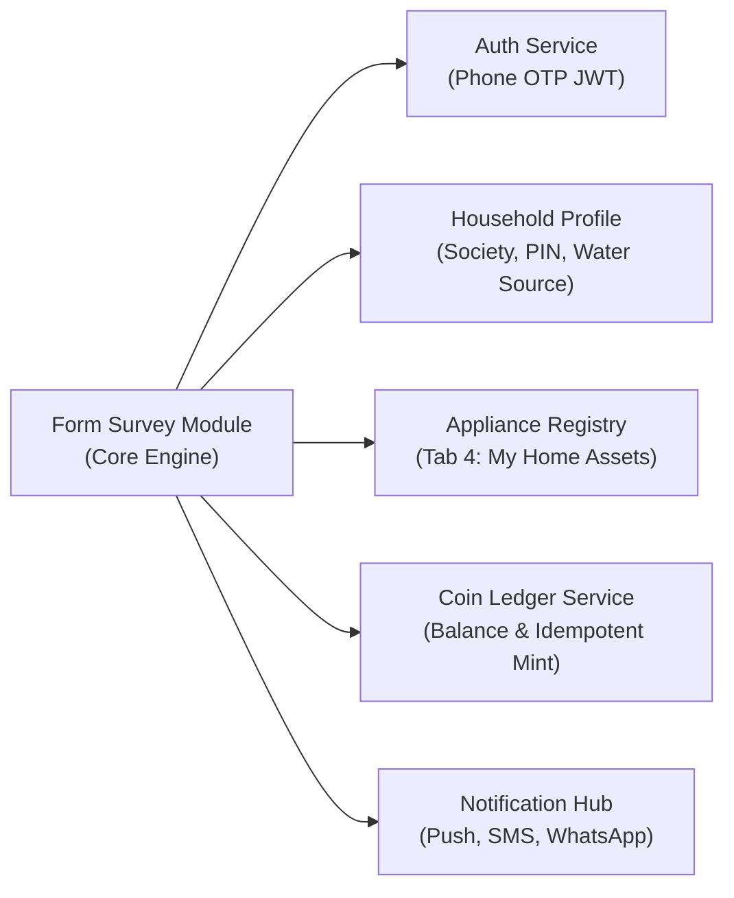

1. **Authentication Service (`auth_service`):** Requires verified user session via SMS OTP (`GHARSURE_USER_ACTION_MAP.md` line 42).
2. **Household Profile Service (`profile_service`):** Supplies verified society ID, city, PIN, and water context.
3. **Appliance Registry (`appliance_service`):** Supplies registered appliance categories, brands, and ages from Tab 4.
4. **Coin Wallet & Ledger (`wallet_service`):** Enforces atomic transaction commits and balance management.
5. **Notification Hub (`notification_service`):** Manages quiet hours, templates, and multi-channel delivery.

---

## Section 24: Open Decisions and Traceability

`Status: PROPOSED (Decision Register & Traceability Matrix)`  
`Requirement ID: FORM-DEC-001`

### 24.1 Open Decision Register

| Decision ID | Architectural / Product Question | Evaluated Options | Recommended Default | Impact / Rationale | Status |
| :--- | :--- | :--- | :--- | :--- | :--- |
| `DEC-SURV-001` | **Survey Runner UX Layout:** Stepper vs. Single Scroll Page? | **A:** Single-question stepper.<br/>**B:** All questions on single page. | **Option A (Stepper)** | Superior mobile ergonomics; enables clean branching without showing irrelevant future questions. | `PROPOSED` |
| `DEC-SURV-002` | **Stale Answers on Backtrack:** Retain vs. Soft-Clear? | **A:** Retain hidden answers.<br/>**B:** Soft-clear hidden answers. | **Option B (Soft-Clear)**| Prevents analytical corruption where answers to mutually exclusive branches are both recorded. | `PROPOSED` |
| `DEC-SURV-003` | **Image Upload in MVP:** Include or Defer? | **A:** Include with strict limits.<br/>**B:** Defer entirely to Phase 2. | **Option A (Include)** | Critical for evidence verification (e.g., photo of TDS meter / filter); mitigated via EXIF scrubbing. | `PROPOSED` |
| `DEC-SURV-004` | **Screener Disqualification Coins:** Fixed or Configurable? | **A:** Fixed at 10 Coins.<br/>**B:** Configurable per survey. | **Option A (Fixed at 10c)**| Consistent user expectation across the platform (aligns with `GHARSURE_USER_ACTION_MAP.md` line 193). | `EXISTING` |
| `DEC-SURV-005` | **Save & Resume Window:** Fixed 48h vs. Configurable? | **A:** Fixed 48 hours.<br/>**B:** Configurable by Admin. | **Option A (Fixed 48h)** | Aligns with existing documented behavior (`GHARSURE_USER_ACTION_MAP.md` line 190); simplifies cache management.| `EXISTING` |
| `DEC-SURV-006` | **In-Flight Quota Reservation:** Hard vs. Soft Lock? | **A:** Hard lock quota on start.<br/>**B:** First-to-submit with 5% buffer.| **Option B (5% Buffer)** | Prevents abandoned sessions from locking out active users while maintaining campaign budget safety. | `PROPOSED` |
| `DEC-SURV-007` | **Feed Scoring Weights:** Static vs. Machine Learning? | **A:** Heuristic static weights.<br/>**B:** Dynamic ML ranking model. | **Option A (Heuristic)** | Simpler to debug, transparent, and avoids cold-start ML complexity for MVP launch. | `PROPOSED` |
| `DEC-SURV-008` | **Sponsor Reporting Access:** Self-serve portal vs. Admin Export? | **A:** Self-serve brand portal.<br/>**B:** Admin-curated export only. | **Option B (Curated Export)**| Enforces strict editorial separation; eliminates risk of brand overreach or PII leakage in MVP. | `PROPOSED` |

### 24.2 Requirements Traceability Matrix

| Requirement ID | Module / Feature Name | UI View / Touch Target | Backend Service Entity | REST API Endpoint | Analytics Event | QA Test Scenario |
| :--- | :--- | :--- | :--- | :--- | :--- | :--- |
| `FORM-CORE-001` | Research Hub Foundation | Tab 2: [For You] Stream | `surveys`, `survey_versions` | `GET /api/v1/surveys/feed` | `survey_feed_viewed` | `TC-SURV-012` |
| `FORM-LIFE-001` | Survey Lifecycle Engine | Admin Console Campaign View | `survey_campaigns` | `POST /admin/surveys/publish` | `campaign_published` | `TC-SURV-001` |
| `FORM-META-001` | Metadata Model | Admin Metadata Editor | `surveys.metadata_snapshot` | `POST /admin/surveys` | `survey_draft_created` | `TC-SURV-014` |
| `FORM-DISC-001` | Survey Card Discovery | Mobile Feed Card Component | `survey_campaigns`, `users` | `GET /api/v1/surveys/feed` | `survey_card_impression`| `TC-SURV-012` |
| `FORM-MATCH-001`| Household Personalization | Reason Badge on Card | `audience_rules`, `user_profile`| `GET /api/v1/surveys/feed` | `survey_card_impression`| `TC-SURV-012` |
| `FORM-TARG-002` | Screener Disqualification | Mobile Question Runner | `survey_sessions`, `answers` | `POST /surveys/sessions/answer` | `survey_screener_dq` | `TC-SURV-002` |
| `FORM-PRE-001` | Pre-Start Experience | Slide-Up Brief Bottom Sheet | `surveys`, `survey_consents` | `GET /api/v1/surveys/{id}` | `survey_detail_viewed` | `TC-SURV-003` |
| `FORM-QUES-001` | Question Schema Engine | Question Stepper UI | `survey_questions`, `options` | `POST /surveys/sessions/answer` | `question_answered` | `TC-SURV-003` |
| `FORM-FLOW-001` | DAG Branching & Stepper | Stepper Progress Bar & Runner| `survey_questions.conditional` | `POST /surveys/sessions/answer` | `question_answered` | `TC-SURV-006` |
| `FORM-SESS-001` | 48h Session Save/Resume | "Save & Exit" Icon Button | `survey_sessions` (Redis TTL) | `POST /surveys/sessions/save` | `survey_draft_saved` | `TC-SURV-004` |
| `FORM-REWARD-001`| Idempotent Coin Minting | Celebration Confetti Modal | `reward_ledger` | `POST /surveys/sessions/complete`| `survey_reward_issued` | `TC-SURV-007` |
| `FORM-ADMIN-001`| 15-Step Admin Builder | Admin Console Builder View | `surveys`, `survey_versions` | `POST /admin/surveys/validate` | `admin_survey_validated`| `TC-SURV-001` |
| `FORM-VERS-001` | Immutability & Pinning | Version History Manager | `survey_versions` | `POST /admin/surveys/version` | `survey_version_bumped` | `TC-SURV-009` |
| `FORM-PRIV-001` | DPDP Consent & Privacy | Privacy Center & Brief Sheet | `survey_consents` | `POST /surveys/{id}/start` | `survey_consent_logged` | `TC-SURV-015` |
| `FORM-NOTIF-001`| Quiet Hours Notifications | System Push Notification | `notification_queue` | N/A (Async Cron Worker) | `notification_dispatched`| `TC-SURV-013` |
| `FORM-QA-001` | Comprehensive Test Suite | CI/CD Automated Test Pipeline| Full Database Schema | All Integration Endpoints | Full Test Telemetry | `TC-SURV-001..016` |

---

## 25. Architectural Sign-Off & Verification

This document constitutes the complete, implementation-ready architectural and product specification for the GharSure Form-Based Survey System. It is authored to enable immediate engineering implementation across backend, admin web, and mobile frontend teams without architectural guesswork, while maintaining strict adherence to verified platform behaviors and Indian statutory data standards (DPDP Act 2023).

**Document Author:** Senior Product Manager, Principal Systems Architect & Senior Full-Stack Engineer  
**Approved for Engineering Implementation:** October 19, 2026
