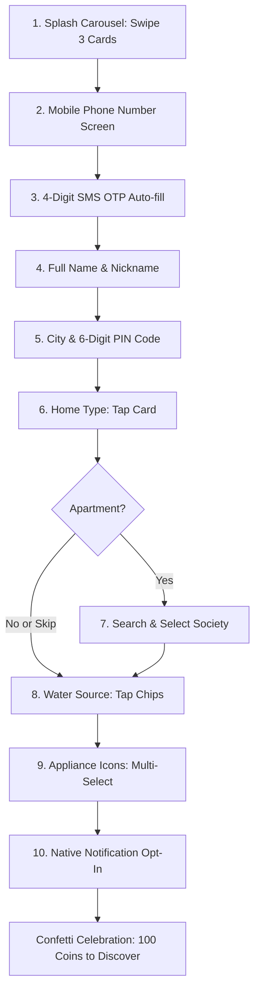
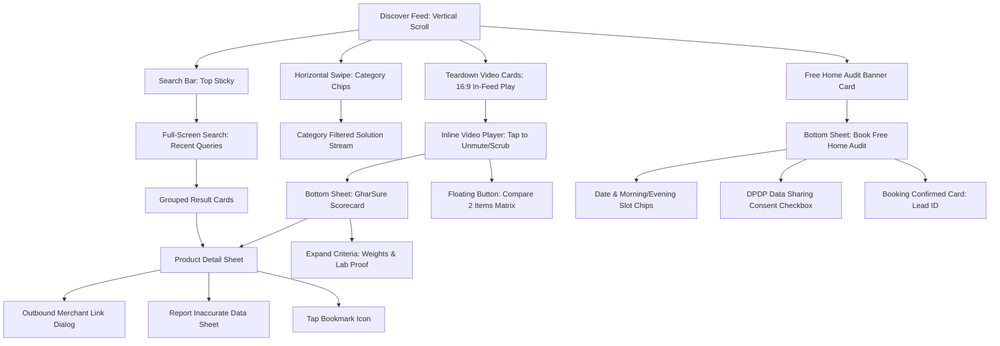
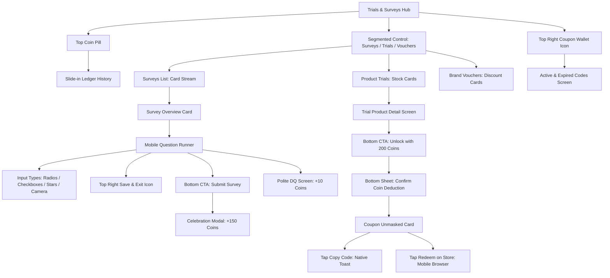
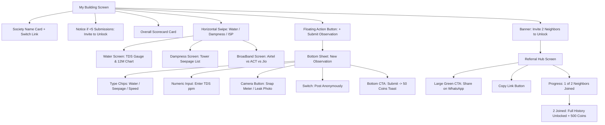
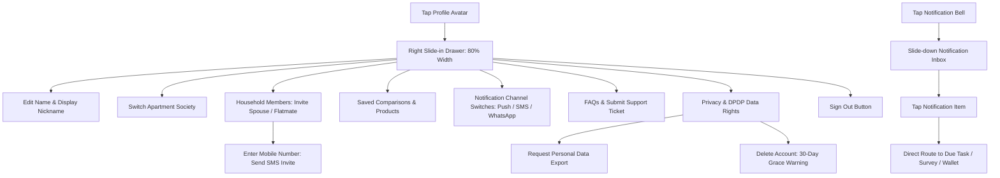

# GharSure: Complete Mobile Navigation & Feature Walkthrough

---

## Table of Contents
1. [Onboarding & First-Time Setup Flow](#1-onboarding--first-time-setup-flow)
2. [Tab 1: Discover — Everything Explained](#2-tab-1-discover--everything-explained)
3. [Tab 2: Trials & Surveys — Everything Explained](#3-tab-2-trials--surveys--everything-explained)
4. [Tab 3: My Building & Referrals — Everything Explained](#4-tab-3-my-building--referrals--everything-explained)
5. [Tab 4: My Home — Everything Explained](#5-tab-4-my-home--everything-explained)
6. [Profile, Notifications & Settings — Everything Explained](#6-profile-notifications--settings-everything-explained)

---

## 1. Onboarding & First-Time Setup Flow

The first-time user experience is a fast, 10-step mobile journey completed in under 90 seconds, featuring mobile SMS auto-fill and quick touch selections.

### Screen-by-Screen Breakdown:
- **Screen 1: Welcome & Value Pitch Carousel**
  - **What the user sees:** 3 full-screen swipeable illustration cards explaining GharSure's core promises: Unbiased Product Teardowns, Society Water Intelligence, and Zero-Cost Product Trials.
  - **User Actions:** Swipe left/right between cards or tap the large bottom button **"Get Started"** to proceed.
- **Screen 2: Phone Number Input**
  - **What the user sees:** Clean mobile number field with pre-filled `+91` prefix. Mobile numeric keypad opens automatically.
  - **User Actions:** User enters 10 digits and taps **"Send OTP"**. A 60-second countdown timer starts to prevent repeated requests.
- **Screen 3: 4-Digit SMS OTP Verification**
  - **What the user sees:** 4 large digit boxes supporting iOS and Android SMS auto-fill.
  - **User Actions:** Entering the 4th digit automatically verifies the code. User can tap **"Resend OTP"** after the timer expires.
- **Screen 4: Profile Name**
  - **What the user sees:** Full Name input and optional Display Name (nickname).
  - **User Actions:** Enter name and tap **"Continue"**.
- **Screen 5: City & Locality PIN Code**
  - **What the user sees:** Quick-select chips for top cities (*Bangalore*, *Mumbai*, *Hyderabad*, *NCR*, *Pune*) and a 6-digit PIN code field.
  - **User Actions:** Typing the 6-digit PIN automatically fetches and displays the locality name (e.g. *Kanakapura Road, Bangalore*). User taps **"Continue"**.
- **Screen 6: Home Type Selection**
  - **What the user sees:** 3 illustrated cards: *Apartment in Gated Society*, *Independent House*, or *Villa*.
  - **User Actions:** Tapping any card highlights it with an orange border and immediately advances.
- **Screen 7: Society Search & Selection (Apartments only)**
  - **What the user sees:** Search bar with live autocomplete for local complexes (e.g. *Sobha Dream Acres*, *Prestige Falcon City*).
  - **User Actions:** Tap a matching society to select it. Prominent bottom link: **"Skip for now"** allows skipping if society is not listed.
- **Screen 8: Household Water Context**
  - **What the user sees:** Multi-select chips asking what water supplies the home: *Borewell*, *Cauvery / Municipal*, or *Private Tankers*.
  - **User Actions:** Tap chips to toggle on/off, then tap **"Continue"**. This context helps GharSure calculate exact water filter replacement intervals later.
- **Screen 9: Initial Appliance Quick-Pick**
  - **What the user sees:** A 2x3 grid of touch cards with icons: *Water Purifier*, *Air Conditioner*, *Refrigerator*, *Washing Machine*, *Geyser*, *Kitchen Chimney*.
  - **User Actions:** Tap multiple icons to select owned appliances. User taps **"Save & Continue"** or taps **"Skip"**.
- **Screen 10: Notification Opt-In & Welcome Bonus**
  - **What the user sees:** Informational card: *"Get alerted before your water filters expire and when new product trials drop"*.
  - **User Actions:** Tapping **"Go to Discover"** prompts native OS notification permissions, triggers a full-screen celebration modal awarding **+100 Welcome Coins**, and drops the resident directly into the Discover feed.

---

## 2. Tab 1: Discover — Everything Explained

The Discover tab is GharSure's intelligence core, designed for vertical mobile scrolling, video teardowns, evidence-backed scorecards, and high-ticket in-home service audits.

### Screen & Feature Walkthrough:

- **Top Sticky Search Bar:**
  - **What the user sees:** A clean search input: *"Search a household problem (e.g. hard water, AC gas leak)..."*.
  - **User Actions:** Tapping opens full-screen search with recent searches and trending tags (*Borewell water filter*, *Dampness in ceiling*, *RO membrane replacement*). Typing displays live filtered results grouped into Videos, Products, and Guides.
- **Category Filter Chips (Horizontal Swipe):**
  - **What the user sees:** Swipeable pill buttons: *Water Quality & Scaling*, *Dampness & Seepage*, *Appliance Longevity*, *Air Purification*, *Kitchen Solutions*.
  - **User Actions:** Tapping a chip filters the entire feed below to focus specifically on solutions for that problem.
- **Featured Comparison & Teardown Video Cards:**
  - **What the user sees:** Video cards showing two competing products side-by-side (e.g. *Kent Grand+ vs Urban Company Native M2*). Displays product pictures, price, and the **GharSure Score** (e.g. `8.4/10`).
  - **In-Card Video Player:** Videos auto-play muted in-feed. Tapping toggles sound on, reveals time scrub slider, pause/resume, and two overlay buttons: **"View Full Scorecard"** and **"Compare"**.
- **The GharSure Scorecard (Slide-Up Bottom Sheet):**
  - **How it opens:** Tapping **"View Full Scorecard"** on any video or product card slides up a bottom sheet to 60% height (draggable to full-screen).
  - **What it contains:**
    - Overall Score (1 to 10) with an Evidence Quality Badge: `HIGH` (lab tested + physical teardown + 20+ resident logs), `MEDIUM` (teardown + verified specs), or `LOW` (manufacturer claims only).
    - 5 Weighted Scoring Criteria (expandable accordions):
      1. *Build Quality (20%):* Plastic grade, internal valve durability, leak protection.
      2. *Functional Efficiency (25%):* Water recovery rate % (wastage ratio), power consumption.
      3. *Serviceability & Parts in India (20%):* Can independent technicians service it? Are replacement filters widely available in Indian cities?
      4. *3-Year Cost of Ownership (20%):* Machine price + mandatory filter changes over 36 months.
      5. *Verified Resident Feedback (15%):* Real ratings from apartment residents.
    - Commercial Transparency: Shows explicit notice: *"GharSure ratings are 100% independent. Commercial partners cannot buy higher scores."*
- **Side-by-Side Product Comparison Matrix:**
  - **How it opens:** User checks 2 products and taps the floating bottom button **"Compare 2 Items"**.
  - **What it contains:** Side-by-side comparison table showing specs, annual maintenance costs, warranty terms, and a "Highlight Differences" toggle.
- **Product Detail View (PDP):**
  - **What it contains:** Full specifications, high-res photos, verified replacement costs, user manual PDF link.
  - **User Actions:**
    - **"Bookmark / Save":** Turns orange, saves to user's personal list in Profile.
    - **"Share":** Opens native mobile share sheet (WhatsApp, Telegram, etc.) with a preview card.
    - **"View on Amazon / Brand Store":** Shows an outbound disclosure modal (*"You are leaving GharSure to visit an external merchant"*), then opens the store in the mobile browser.
    - **"Report Incorrect Info":** Opens a quick modal to report wrong specs or outdated pricing.
- **Book Free Home Audit (High-Ticket Lead):**
  - **What it is:** A card in the feed offering an in-person water hardness or dampness audit conducted by certified partners (e.g. *EcoWater Labs*).
  - **Tapping "Book Free Home Audit" opens a slide-up sheet:**
    - Pincode check confirms partner availability.
    - Date picker and Morning (9 AM - 1 PM) / Evening (2 PM - 6 PM) slot chips.
    - Resident contact number and flat address confirmation.
    - Mandatory DPDP consent box: *"I authorize GharSure to share my contact and address with [Partner Name] solely for scheduling this audit."*
    - Submitting shows confirmed Lead ID (`AUD-XXXXX`) and status (*Scheduled*).
    - User can cancel anytime up to 4 hours before the appointment.

---

## 3. Tab 2: Trials & Surveys — Everything Explained

The zero-spam rewards hub where residents participate in brand studies, earn GharSure Coins, and redeem them for free product trials and vouchers.

### Screen & Feature Walkthrough:

- **Top Wallet Summary:**
  - Displays user's live GharSure Coins (e.g. `450 Coins`).
  - Tapping opens the **Coin Ledger**, displaying an audit trail of every coin earned (Welcome bonus, survey completions, referrals) and spent (trial unlocks, vouchers).
- **3-Segment Sub-Navigation Bar:**
  - Sticky below the header, user can tap between: **[For You]**, **[Product Trials]**, and **[Vouchers]**.
- **Sub-Tab 1: For You (Surveys & Studies):**
  - **What it contains:** Targeted survey cards matched to user's home context (e.g. *Bangalore Monsoon Borewell Water Study — 150 Coins*). Shows estimated time (4 mins) and closing date.
  - **Survey Brief Screen:** Explains who is conducting the research, what will be asked, and the reward rules. User taps **"Start Survey"**.
  - **Question Runner:**
    - Progress bar at the top (e.g. *Question 3 of 6*).
    - Question Types: Single-choice radio buttons, multi-select checkboxes, 1–5 star rating sliders, short text input boxes, or camera photo uploads (e.g. snap your water filter cartridge).
    - Navigation: "Previous" button, "Next" button, and a **"Save & Exit"** icon at top right (saves draft to resume within 48 hours).
    - Outcomes:
      - Finishing all questions triggers a celebration popup: **"+150 Coins Credited to Your Wallet"**.
      - If user fails a screening criteria (e.g. does not live in Bangalore), a polite screen appears: *"Thank you! You do not match this campaign's target cohort. 10 appreciation coins have been added to your wallet."*
- **Sub-Tab 2: Product Trials:**
  - **What it contains:** Cards for free or heavily subsidized physical trial products (e.g. *Plant-based appliance descaler pack worth ₹399*, *Dishwasher tablet sample kit*).
  - Each card shows: Product photo, description, coin cost (e.g. *200 Coins*), and live remaining stock counter (e.g. *14 packs left*).
  - **Unlocking Flow:**
    - User taps **"Unlock with 200 Coins"**.
    - Bottom sheet confirms wallet deduction: *"Deduct 200 Coins from your balance (450 available)?"*.
    - User taps **"Confirm Unlock"**.
    - The masked box unmasks a unique single-use coupon code (e.g. `GHAR-ECO-9821`).
    - User taps **"Copy Code"** (triggers haptic click and toast: *"Code copied!"*).
    - User taps **"Redeem on Partner Store"** to open the merchant checkout where they paste the code for 100% off.
- **Sub-Tab 3: Brand Vouchers:**
  - **What it contains:** Exclusive discount vouchers across kitchen appliances, water filters, and home cleaning brands.
  - Filter by category pills (*Kitchen*, *Water*, *Cleaning*).
  - Tapping a voucher shows validity dates, minimum spend requirements, and exclusions.
  - Tapping **"Claim Voucher"** saves the voucher code directly to the user's wallet.
- **My Coupon Wallet:**
  - Tapping the wallet icon in the top right opens the user's active vouchers and trials, divided into: *Active*, *Redeemed*, and *Expired*.

---

## 4. Tab 3: My Building & Referrals — Everything Explained

Hyperlocal community intelligence giving residents verified building water tests, dampness logs, broadband ratings, and neighbor referral rewards.

### Screen & Feature Walkthrough:

- **Building Header:**
  - Shows apartment complex name and locality (e.g. *Prestige Falcon City, Kanakapura Road*).
  - Tapping **"Change Society"** lets residents search and switch buildings.
- **Quarantine Threshold Protection:**
  - If a building has fewer than 5 resident submissions, raw ratings are hidden to prevent misinformation. Instead, a progress card appears: *"Building intelligence gathering in progress (2 of 5 observations received). Invite a neighbor to unlock."*
- **Building Collective Scorecard:**
  - Displays overall property score (e.g. `78/100`) based on verified resident contributions.
  - Divided into 3 horizontal swipeable intelligence cards:
    1. **Water Intelligence Report:**
       - Average borewell TDS (e.g. `820 ppm - High Hardness`).
       - Source breakdown pie chart (% Cauvery municipal water, % Borewell, % Private Tankers).
       - 12-month seasonal TDS fluctuation graph showing monsoon vs summer spikes.
       - Recommended RO membrane rating for the complex.
       - Prominent scientific disclaimer: *"TDS measures dissolved minerals; it is not an indicator of bacteria or microbiological safety."*
    2. **Dampness & Seepage Report:**
       - Tower-by-tower seepage logs (e.g. *Tower 4 external shaft seepage, Basement 2 monsoon pooling*).
       - Severity rating (Low / Moderate / Severe).
       - History of waterproofing treatments in the complex.
    3. **Broadband & Utility Matrix:**
       - Real resident ratings and uptime % for top ISPs in the building (e.g. *Airtel Fiber 4.8/5 (92 residents)* vs *ACT Fibernet 4.1/5 (45 residents)* vs *JioFiber 3.9/5*).
- **Submit Building Observation (Floating `+` Button):**
  - Tapping the circular `+` button in the bottom right corner opens the submission modal:
    - Select observation type: *Water TDS*, *Dampness/Leak*, or *Broadband Speed*.
    - Enter metrics (e.g. digital TDS meter reading).
    - Tap Camera button to snap photo proof of the meter screen or wall seepage.
    - Checkbox: **"Submit Anonymously"** (keeps flat number and identity completely private).
    - Tapping **"Submit"** verifies the data and awards **+50 Coins**.
- **Neighbor Referral Hub (The 2-Neighbor Unlock):**
  - A prominent banner on the building tab: *"Invite 2 Neighbors -> Unlock Complete Society History & Earn 500 Coins"*.
  - Tapping opens the referral hub:
    - Visual progress bar: *e.g. 1 of 2 neighbors joined*.
    - Large green button: **"Share on WhatsApp"** (immediately opens WhatsApp with a pre-written invite containing the society deep link).
    - **"Copy Link"** button for sharing anywhere.
    - List of invited neighbors with masked phone numbers (*+91 98XXX XXX12 - Verified*).
    - When 2 verified neighbors from the same complex join: full historical graphs unlock for the resident + **500 Coins** are credited to their wallet.

---

## 5. Tab 4: My Home — Everything Explained

A private appliance asset registry, automated maintenance scheduler, and financial repair-vs-replace decision calculator.

```mermaid
flowchart TD
    HomeRoot["My Home Dashboard"] --> UrgentBanner["Top Urgent Alert: Overdue Tasks"]
    HomeRoot --> ApplianceScroll["Horizontal Carousel: Registered Appliances"]
    HomeRoot --> AddBtn["Card: + Add New Appliance"]
    HomeRoot --> TaskList["Vertical List: Upcoming Maintenance Tasks"]
    HomeRoot --> CalcCard["Feature Card: Repair vs Replace Calculator"]

    AddBtn --> AddWizard["Slide-up Wizard: Add Appliance"]
    AddWizard --> CatPicker["Category Grid: Purifier, AC, Fridge, etc."]
    AddWizard --> BrandInput["Brand & Model Autocomplete Input"]
    AddWizard --> DatePicker["Native Mobile Date Picker: Install Date"]
    AddWizard --> InvoiceSnap["Camera Icon: Snap Paper Receipt"]
    InvoiceSnap --> SaveAsset["Save Appliance: Auto-Build Schedule"]

    ApplianceScroll --> AssetDetail["Appliance Detail Sheet"]
    AssetDetail --> WarrantyBadge["Warranty Countdown Badge"]
    AssetDetail --> EditArchive["Edit / Archive / Delete Options"]

    UrgentBanner --> TaskActionSheet["Bottom Sheet: Maintenance Task"]
    TaskList --> TaskActionSheet
    TaskActionSheet --> StepByStepDIY["DIY Steps & Required Parts"]
    TaskActionSheet --> MarkDoneBtn["CTA: Mark Done -> Enter Cost"]
    TaskActionSheet --> SnoozeBtn["Snooze Chips: 7d / 14d / 30d"]
    TaskActionSheet --> TurnOffBtn["Text Link: Disable Reminder"]

    CalcCard --> CalcScreen["Calculator Screen"]
    CalcScreen --> AgeSlider["Touch Slider: Appliance Age"]
    CalcScreen --> RepairInput["Currency Input: Quoted Repair Cost"]
    CalcScreen --> NewPriceInput["Currency Input: New Replacement Price"]
    CalcScreen --> CalcVerdictCard["Live Verdict: REPAIR vs REPLACE Badge"]
    CalcVerdictCard --> GetQuoteCTA["Button: Request Vetted Service Quote"]
```

### Screen & Feature Walkthrough:

- **Household Header Bar:**
  - Displays registered home address and avatars of household members.
- **Urgent Maintenance Alert Banner:**
  - Appears at the very top in amber if any task is due or overdue (e.g. *Water Purifier: Sediment filter due for replacement*).
  - Quick action buttons: **"Mark Completed"** or **"Snooze 7 Days"**.
- **Registered Appliance Asset Carousel (Horizontal Swipe):**
  - Displays cards for all registered appliances in the household (e.g. *AO Smith RO Purifier*, *Daikin 1.5T AC*, *LG Refrigerator*).
  - Each card shows: Brand, Model, approximate age, warranty badge (*Under Warranty* or *Warranty Expired*), and maintenance health status (*Healthy* or *Service Due*).
- **"+ Add Appliance" Wizard:**
  - Tapping **"+ Add Appliance"** opens a slide-up wizard:
    - Step 1: Pick category (*RO Water Purifier*, *Air Conditioner*, *Refrigerator*, *Washing Machine*, *Geyser*, *Chimney*, *Microwave*, *Inverter*).
    - Step 2: Enter Brand and Model with instant autocomplete.
    - Step 3: Pick installation date using native mobile date picker.
    - Step 4 (Optional): Snap a photo of the purchase receipt or serial number sticker.
    - Step 5: Tapping **"Save Appliance"** stores the asset and automatically builds the recurring service schedule based on manufacturer recommendations and local water hardness.
- **Appliance Detail Screen:**
  - Tapping any appliance card opens its full view:
    - Warranty countdown timer and digital user manual link.
    - Chronological service history timeline showing past repairs, dates, and costs.
    - Options to Edit specs, Archive appliance, or Delete asset.
- **Maintenance Schedule & Task Cards:**
  - Tapping an upcoming task (e.g. *AC pre-summer deep cleaning*) opens the task detail sheet:
    - Explains why the task is needed (*Manufacturer recommended interval* vs *GharSure local heuristic*).
    - DIY step-by-step cleaning guide and required replacement parts.
    - Estimated technician cost benchmark.
    - Buttons:
      - **"Mark Completed":** Opens a quick form to log service date, amount paid (₹), and optional photo of service bill.
      - **"Snooze":** Postpones reminder by 7, 14, or 30 days.
      - **"Disable Reminder":** Silences alerts for this task.
- **Repair vs Replace Financial Calculator:**
  - Accessible via a featured card on the dashboard or directly from an appliance view.
  - Interactive inputs:
    - Select appliance.
    - Touch slider to set appliance age (e.g. *7 years*).
    - Enter quoted repair estimate (e.g. *₹6,500*).
    - Enter price of a new replacement model (e.g. *₹38,000*).
  - Calculation Engine:
    - Evaluates the 50% Rule (is repair > 50% of new unit cost?).
    - Checks lifespan percentile (is unit past 70% of expected life?).
    - Calculates annual electricity savings of a new 5-star inverter model.
  - Clear Visual Verdict:
    - Large badge: **`REPAIR RECOMMENDED`** (if unit is young and repair is cheap) OR **`REPLACE RECOMMENDED`** (if unit is old and energy savings will offset replacement cost within 2 years).
    - Transparent mathematical explanation.
    - Button: **"Request Vetted Service Quote"** to connect with local certified service partners.

---

## 6. Profile, Notifications & Settings — Everything Explained

Personal settings, household collaboration, notification management, and statutory data rights under India's DPDP Act 2023.

### Screen & Feature Walkthrough:

- **Slide-in Profile Drawer:**
  - Tapping the profile avatar in the top header slides in a drawer from the right (80% screen width) with background dimming.
  - Contains:
    - **User Card:** Name, phone number, display nickname, and "Edit Profile" link.
    - **Switch Society:** Allows moving to a new apartment building (shows warning that building scorecards will switch).
    - **Household Members:** View family members/roommates. Tap **"Invite Member"** to enter a phone number and assign roles (*Admin* can add/delete appliances; *Member* can view and mark tasks done).
    - **Saved Items:** View bookmarked teardown videos, product scorecards, and problem solutions.
    - **Help & Support:** Searchable FAQ accordions and **"Submit Support Ticket"** form.
    - **Privacy & Data Rights (DPDP Act):**
      - **"Export My Data":** Generates an encrypted downloadable file of all user assets and service history.
      - **"Delete Account":** Initiates a 30-day grace period notice before permanent erasure.
    - **"Sign Out":** Logs out and clears local session.
- **Notification Center:**
  - Tapping the bell icon slides down the notification inbox with tabs: *All*, *Reminders*, *Surveys*, and *Rewards*.
  - Tapping any notification deep-links directly to the relevant maintenance task, survey, or wallet transaction.
- **Notification Channel Settings:**
  - Touch toggle switches to turn alerts on/off for Push Notifications, SMS, and WhatsApp.
  - Automatic quiet hours enforced between 9:00 PM and 8:00 AM IST.

---
*End of GharSure Mobile Navigation & Feature Walkthrough.*
