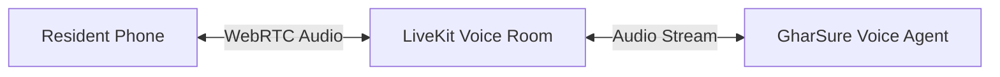
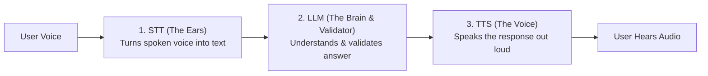
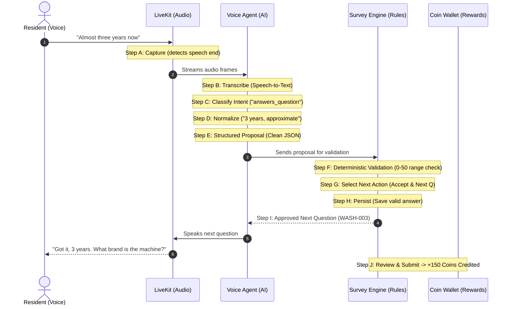

# GharSure AI Voice Survey: The 10-Step Pipeline & LiveKit Integration

This document explains:
1. **How we use LiveKit** for realtime two-way voice communication.
2. **How survey questions look** (clean, simple question schema).
3. **The complete 10-step voice pipeline** (from spoken audio to coin rewards).
4. **How the system handles real-life conversation situations** (all 9 cases).

---

## 1. How We Use LiveKit in GharSure

### What is LiveKit?
**LiveKit** is the realtime audio infrastructure that connects the resident's phone to the AI interviewer. Think of it like a private, ultra-fast voice call between the resident and the AI survey agent.



### Why We Use LiveKit:
* **Zero Lag:** Traditional voice bots feel slow and awkward because audio uploads in chunks. LiveKit streams audio continuously over WebRTC, so the conversation feels as instant as talking to a real human on the phone.
* **Smart Voice Activity Detection (VAD):** LiveKit knows exactly when the user starts speaking and when they stop, without requiring the user to press or hold any button.
* **Handles Interruptions Naturally:** If the AI is speaking and the user starts talking, LiveKit detects it immediately and stops the AI from speaking so the user is never talked over.
* **Works Flawlessly on Mobile:** Runs smoothly on Android and iPhone mobile browsers and native apps without dropping audio.

### How the Voice Call Flows Step-by-Step:
1. **Resident taps "Start Voice Survey"**: The GharSure app requests microphone permission.
2. **Joining the LiveKit Room**: The app receives a secure, temporary connection pass from GharSure and joins a private LiveKit audio room.
3. **AI Agent Joins**: The GharSure Voice Agent joins the same room and greets the resident out loud.
4. **Natural Two-Way Speech**: The resident speaks into their phone mic $\rightarrow$ LiveKit delivers the audio stream instantly to the agent $\rightarrow$ The agent understands the answer $\rightarrow$ The agent speaks the next question back through the phone speaker.
5. **Clean Exit**: When the survey ends, the room automatically closes.

---

### How STT, LLM, and TTS Work Together Inside LiveKit

Inside the LiveKit Agent, three AI pieces work as a single team:



#### 1. STT — Speech-to-Text (The Ears)
* **What it does:** Listens to the incoming audio from LiveKit and transcribes it into written text in real time.
* **Why it's smart:** Understands Indian accents, household terms, and mixed Hinglish (*"3 saal se"*).
* **Tools used:** Deepgram or OpenAI Whisper plugin inside LiveKit.

#### 2. LLM — Language Model (The Brain & Validator)
* **What it does inside LiveKit:**
  * **Understands the meaning:** Knows what question is currently being asked and interprets what the resident meant.
  * **Normalizes the answer:** Converts casual phrases like *"around three years"* into clean data (`3 years`).
  * **Performs Validation on the spot:** Checks the answer against the question's rules (e.g., checks if the age is between 0 and 50 years, or if a chosen option is valid).
  * **Decides the next spoken step:** 
    * If valid $\rightarrow$ prepares the next approved survey question.
    * If vague or out of bounds $\rightarrow$ generates a polite clarification question (e.g., *"Could you estimate roughly how many years?"*).
    * If off-topic $\rightarrow$ prepares a polite redirect back to the survey.
* **Tools used:** OpenAI GPT-4o-mini or Google Gemini plugin inside LiveKit.

#### 3. TTS — Text-to-Speech (The Voice)
* **What it does:** Takes the text prepared by the LLM (either the next question or a clarification) and speaks it out loud in a natural, warm, human-like voice.
* **Why it's fast:** Streams audio back through LiveKit instantly so the resident hears the reply with zero awkward delay.
* **Tools used:** Cartesia Sonic or ElevenLabs plugin inside LiveKit.


---

## 2. How the Question Schema Looks

Each survey question is defined simply with its ID, text, type, and simple validation bounds:

### Example 1: Duration Question (`WASH-002`)
```json
{
  "questionId": "WASH-002",
  "order": 2,
  "text": "How long have you been using your washing machine?",
  "answerType": "duration",
  "required": true,
  "normalizationRules": {
    "canonicalUnit": "years",
    "allowApproximate": true
  },
  "validationRules": {
    "minimum": 0,
    "maximum": 50
  },
  "allowSkip": false,
  "maxClarificationAttempts": 2
}
```

### Example 2: Single-Choice Question (`RO-001`)
```json
{
  "questionId": "RO-001",
  "order": 1,
  "text": "What is the primary source of water in your flat?",
  "answerType": "single_choice",
  "required": true,
  "allowedOptions": [
    { "optionId": "OPT_1", "value": "Borewell Water" },
    { "optionId": "OPT_2", "value": "Cauvery / Municipal Water" },
    { "optionId": "OPT_3", "value": "Private Tanker" }
  ],
  "allowSkip": false,
  "maxClarificationAttempts": 2
}
```

### Example 3: Number Question (`RO-002`)
```json
{
  "questionId": "RO-002",
  "order": 3,
  "text": "What is the measured TDS level of your drinking water?",
  "answerType": "number",
  "required": false,
  "validationRules": {
    "minimum": 10,
    "maximum": 3000,
    "unit": "ppm"
  },
  "allowSkip": true,
  "maxClarificationAttempts": 2
}
```

### Supported Answer Types
* `duration` (e.g., "3 years", "6 months")
* `number` (e.g., TDS reading: 450)
* `single_choice` (e.g., Borewell vs. Municipal)
* `multiple_choice` (e.g., select owned appliances)
* `boolean` (Yes / No)
* `rating` (1 to 5 stars)
* `short_text` / `long_text` (feedback and comments)

---

## 3. The Complete 10-Step Voice Pipeline

Every single spoken response from the resident goes through this 10-step pipeline:



### Detailed Breakdown of the 10 Steps:

* **Step A: Capture**  
  The resident speaks into their microphone. LiveKit listens and automatically detects when the resident finishes speaking after a natural silence pause ($\sim 600$ milliseconds).

* **Step B: Transcribe**  
  Speech-to-text turns the spoken audio into text in real time. It handles Indian accents, household terms, and mixed Hinglish (*"3 saal se"*).

* **Step C: Classify Intent**  
  The system identifies what the resident meant by choosing one of these clean labels:
  * `answers_question` — Answered the question directly.
  * `partially_answers_question` — Gave partial information.
  * `needs_clarification` — Vague or ambiguous answer.
  * `off_topic` — Asked something unrelated (e.g., weather or jokes).
  * `skip_requested` — Asked to skip the question.
  * `repeat_requested` — Asked to repeat the question.
  * `correction` — Corrected an earlier answer.
  * `pause_requested` — Asked to pause or hold on.
  * `resume_requested` — Ready to continue.
  * `exit_requested` — Wants to stop.
  * `unknown` — Inaudible noise or background television.

* **Step D: Normalize**  
  Converts casual conversational speech into clean, standardized data:
  * *"Around three years"* $\rightarrow$ **3 years (approximate)**
  * *"Borewell water"* $\rightarrow$ **Option: Borewell Water**
  * *"Haanji, yes"* $\rightarrow$ **true**

* **Step E: Produce Structured Interpretation**  
  The AI packages the interpretation into a clean, simple proposal:
```json
{
  "sessionId": "session_123",
  "turnId": "turn_007",
  "questionId": "WASH-002",
  "intent": "answers_question",
  "transcript": "Almost three years now",
  "normalizedAnswer": {
    "value": 3,
    "unit": "years",
    "approximate": true
  },
  "interpretationConfidence": "high",
  "needsClarification": false,
  "clarificationReason": null,
  "additionalInformation": [],
  "suggestedFollowUp": null
}
```

* **Step F: Deterministic Backend Validation**  
  The backend server (not the AI) validates the answer against the question's rules:
  * Is the answer within allowed limits (e.g., 0 to 50 years)?
  * Is the choice one of the allowed options?
  * The AI **cannot** bypass these checks or force an invalid answer.

* **Step G: Select the Next Action**  
  The backend decides the immediate next action:
  * **Accept & Advance:** Answer is good $\rightarrow$ move to next question.
  * **Clarify:** Answer is vague $\rightarrow$ ask a polite follow-up.
  * **Repeat:** Repeat the question.
  * **Pause:** Save progress and hold.
  * **Redirect:** Politely redirect an off-topic question back to the survey.

* **Step H: Persist**  
  The accepted answer is permanently saved in the database before moving forward. If the user corrected a previous question, the system updates that answer and keeps a clean history.

* **Step I: Continue**  
  The backend picks the next approved question based on the survey plan and sends the text to the LiveKit agent to speak out loud.

* **Step J: Review & Submit**  
  When all questions are answered, the resident sees a clean summary on their phone screen. Once confirmed, **+150 GharSure Coins** are credited directly to their wallet.

---

## 4. How the AI Handles 9 Real-Life Situations

| Case # | What Happens | What the Resident Says | What the System Does |
| :-: | :--- | :--- | :--- |
| **Case 1** | **Clear Answer** | *"Around three years."* | Normalizes to `3 years`, saves the answer, says: *"Got it, around three years."*, and moves to the next question. |
| **Case 2** | **Ambiguous Answer** | *"Quite a long time."* | Asks politely: *"Could you estimate roughly how many years or months that has been?"* (Max 2 attempts). |
| **Case 3** | **Unrelated Question** | *"What's the weather tomorrow?"* | Politely redirects: *"I can only help with your GharSure survey today! Could you let me know about your washing machine?"* |
| **Case 4** | **Extra Details** | *"Three years, and it makes loud noise when spinning."* | Saves `3 years` as the appliance age, and saves the noise complaint separately as an extra research note. |
| **Case 5** | **Correction** | *"Wait, earlier I said 3 years, but I meant 5 years."* | Updates the previous washing machine answer to `5 years`, confirms it, and returns to the current question. |
| **Case 6** | **Doesn't Know** | *"I don't know the exact TDS number."* | If question allows skipping, marks as "Not sure" and advances without forcing a guess. |
| **Case 7** | **Repeat Request** | *"Can you repeat that?"* | Repeats the exact question clearly without moving forward. |
| **Case 8** | **Pause or Stop** | *"I need to answer the door, hold on."* | Pauses the survey, saves all progress for up to 48 hours, and lets the resident resume later. |
| **Case 9** | **Bad Audio / Noise** | Loud background noise / static | Asks once to repeat. If sound remains poor, offers a 1-tap button to switch to the normal on-screen form. |

---

## 5. Summary of Safety & Privacy Rules

* **LiveKit Audio is Never Stored:** Spoken voice is processed live in memory and immediately discarded. No audio recordings are ever saved to disk.
* **The AI Cannot Hand Out Coins:** The AI assistant has zero ability to touch user balances. Coins are only minted by GharSure's secure backend after the full survey is verified.
* **Fairness:** If a survey is meant for RO purifier owners and the resident doesn't have one, the survey finishes early and awards **+10 Coins** as a thank-you for their time.
* **Always a Choice:** If a resident prefers not to speak, they can tap **"Switch to Form"** at any time and complete the survey by tapping on screen.
