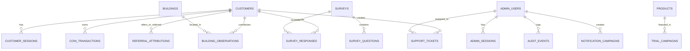

# GharSure PostgreSQL Database Schema (Complete Reference)

This document provides the complete, consolidated database schema across all **18 active tables** in Supabase PostgreSQL, categorized by functional domain.

---

## Entity Relationship Overview



---

## 1. Customer & Authentication System

### `customers`
Stores customer profile records with sequential readable customer IDs (`GH000001`), verified phone numbers, and unique referral codes.

```sql
CREATE TABLE customers (
  id UUID PRIMARY KEY DEFAULT gen_random_uuid(),
  customer_id VARCHAR(16) UNIQUE NOT NULL DEFAULT ('GH' || lpad(nextval('customer_id_seq')::text, 6, '0')),
  auth_user_id UUID UNIQUE,
  phone_e164 VARCHAR(20) UNIQUE NOT NULL,
  phone_verified_at TIMESTAMPTZ,
  full_name VARCHAR(100),
  display_name VARCHAR(50),
  city VARCHAR(100),
  onboarding_completed BOOLEAN NOT NULL DEFAULT false,
  status VARCHAR(20) NOT NULL DEFAULT 'ACTIVE' CHECK (status IN ('ACTIVE', 'SUSPENDED', 'DELETED')),
  reward_coins INT NOT NULL DEFAULT 100,
  support_notes TEXT,
  household_details JSONB DEFAULT '{}'::jsonb,
  referral_code VARCHAR(30) UNIQUE NOT NULL DEFAULT generate_unique_referral_code(),
  created_at TIMESTAMPTZ NOT NULL DEFAULT now(),
  updated_at TIMESTAMPTZ NOT NULL DEFAULT now()
);
```

### `customer_sessions`
Active customer JWT sessions and device tracking.

```sql
CREATE TABLE customer_sessions (
  id UUID PRIMARY KEY DEFAULT gen_random_uuid(),
  customer_id UUID NOT NULL REFERENCES customers(id) ON DELETE CASCADE,
  session_token_hash VARCHAR(64) UNIQUE NOT NULL,
  ip_address VARCHAR(45),
  user_agent TEXT,
  last_active_at TIMESTAMPTZ NOT NULL DEFAULT now(),
  expires_at TIMESTAMPTZ NOT NULL,
  created_at TIMESTAMPTZ NOT NULL DEFAULT now()
);
```

### `otp_challenges`
Tracks OTP authentication challenges with rate limiting, cooldown, and attempt tracking.

```sql
CREATE TABLE otp_challenges (
  id UUID PRIMARY KEY DEFAULT gen_random_uuid(),
  phone_e164 VARCHAR(20) NOT NULL,
  otp_hash VARCHAR(64) NOT NULL,
  attempts INT NOT NULL DEFAULT 0,
  max_attempts INT NOT NULL DEFAULT 5,
  resend_count INT NOT NULL DEFAULT 0,
  expires_at TIMESTAMPTZ NOT NULL,
  verified_at TIMESTAMPTZ,
  ip_address VARCHAR(45),
  created_at TIMESTAMPTZ NOT NULL DEFAULT now()
);
```

---

## 2. Coin Ledger & Referral Program

### `coin_transactions`
Append-only immutable transaction ledger for all coin emissions and redemptions.

```sql
CREATE TABLE coin_transactions (
  id UUID PRIMARY KEY DEFAULT gen_random_uuid(),
  customer_id UUID NOT NULL REFERENCES customers(id) ON DELETE CASCADE,
  amount INT NOT NULL,
  type VARCHAR(50) NOT NULL CHECK (type IN ('SURVEY_REWARD', 'REFERRAL_BONUS', 'STORE_REDEMPTION', 'MANUAL_ADJUSTMENT', 'WELCOME_BONUS')),
  description TEXT NOT NULL,
  idempotency_key VARCHAR(128) UNIQUE NOT NULL,
  admin_id UUID REFERENCES admin_users(id) ON DELETE SET NULL,
  metadata JSONB DEFAULT '{}'::jsonb,
  created_at TIMESTAMPTZ NOT NULL DEFAULT now()
);
```

### `referral_attributions`
Tracks inviter-invitee pairings, conversion status, and bonus coin issuance.

```sql
CREATE TABLE referral_attributions (
  id UUID PRIMARY KEY DEFAULT gen_random_uuid(),
  referrer_id UUID NOT NULL REFERENCES customers(id) ON DELETE CASCADE,
  referee_id UUID NOT NULL REFERENCES customers(id) ON DELETE CASCADE,
  referral_code VARCHAR(50) NOT NULL,
  status VARCHAR(30) NOT NULL DEFAULT 'PENDING' CHECK (status IN ('PENDING', 'QUALIFIED', 'REWARDED', 'REJECTED')),
  reward_coins INT NOT NULL DEFAULT 100,
  referrer_reward_coins INT NOT NULL DEFAULT 100,
  referee_reward_coins INT NOT NULL DEFAULT 100,
  rejection_reason TEXT,
  metadata JSONB DEFAULT '{}'::jsonb,
  created_at TIMESTAMPTZ NOT NULL DEFAULT now(),
  qualified_at TIMESTAMPTZ,
  CONSTRAINT uq_referral_referee UNIQUE (referee_id),
  CONSTRAINT check_referral_no_self_referral CHECK (referrer_id != referee_id)
);
```

---

## 3. Admin & Governance

### `admin_users`
Administrator directory with Role-Based Access Control (RBAC).

```sql
CREATE TABLE admin_users (
  id UUID PRIMARY KEY DEFAULT gen_random_uuid(),
  email VARCHAR(255) UNIQUE NOT NULL,
  full_name VARCHAR(255) NOT NULL,
  password_hash TEXT NOT NULL,
  role VARCHAR(50) NOT NULL CHECK (role IN ('SUPER_ADMIN', 'OPERATIONS_ADMIN', 'CONTENT_MANAGER', 'SUPPORT_ADMIN', 'ANALYST')),
  status VARCHAR(20) NOT NULL DEFAULT 'ACTIVE' CHECK (status IN ('ACTIVE', 'SUSPENDED', 'INVITED')),
  permissions TEXT[] DEFAULT '{}',
  invited_by UUID REFERENCES admin_users(id) ON DELETE SET NULL,
  created_at TIMESTAMPTZ NOT NULL DEFAULT now(),
  updated_at TIMESTAMPTZ NOT NULL DEFAULT now(),
  last_login_at TIMESTAMPTZ
);
```

### `admin_sessions`
Authenticated sessions for administrative staff.

```sql
CREATE TABLE admin_sessions (
  id UUID PRIMARY KEY DEFAULT gen_random_uuid(),
  admin_id UUID NOT NULL REFERENCES admin_users(id) ON DELETE CASCADE,
  session_token_hash VARCHAR(64) UNIQUE NOT NULL,
  ip_address VARCHAR(45),
  user_agent TEXT,
  expires_at TIMESTAMPTZ NOT NULL,
  created_at TIMESTAMPTZ NOT NULL DEFAULT now()
);
```

### `audit_events`
System-wide security and administrative action audit trail.

```sql
CREATE TABLE audit_events (
  id UUID PRIMARY KEY DEFAULT gen_random_uuid(),
  event_type VARCHAR(100) NOT NULL,
  actor_type VARCHAR(30) DEFAULT 'CUSTOMER',
  phone_e164 VARCHAR(20),
  customer_id UUID REFERENCES customers(id) ON DELETE SET NULL,
  admin_id UUID REFERENCES admin_users(id) ON DELETE SET NULL,
  ip_address VARCHAR(45),
  metadata JSONB DEFAULT '{}'::jsonb,
  created_at TIMESTAMPTZ NOT NULL DEFAULT now()
);
```

### `system_settings`
Runtime configuration key-value store (campaign rules, feature flags, moderation policies).

```sql
CREATE TABLE system_settings (
  key VARCHAR(100) PRIMARY KEY,
  value JSONB NOT NULL,
  description TEXT,
  updated_by UUID REFERENCES admin_users(id) ON DELETE SET NULL,
  updated_at TIMESTAMPTZ NOT NULL DEFAULT now()
);
```

---

## 4. Product Intelligence & Store Trials

### `products`
Catalog of appliances, water purifiers, and home care items with scorecard analytics.

```sql
CREATE TABLE products (
  id UUID PRIMARY KEY DEFAULT gen_random_uuid(),
  title VARCHAR(255) NOT NULL,
  category VARCHAR(100) NOT NULL,
  brand VARCHAR(100) NOT NULL,
  summary TEXT,
  specifications JSONB DEFAULT '{}'::jsonb,
  price_inr NUMERIC(10,2) NOT NULL DEFAULT 0.00,
  score NUMERIC(3,1) DEFAULT NULL,
  scorecard_details JSONB DEFAULT '{}'::jsonb,
  evidence_sources JSONB DEFAULT '[]'::jsonb,
  status VARCHAR(30) NOT NULL DEFAULT 'PUBLISHED' CHECK (status IN ('DRAFT', 'PUBLISHED', 'ARCHIVED')),
  created_at TIMESTAMPTZ NOT NULL DEFAULT now(),
  updated_at TIMESTAMPTZ NOT NULL DEFAULT now()
);
```

### `trial_campaigns`
Zero-cost and coin-redeemable trial campaigns for home products.

```sql
CREATE TABLE trial_campaigns (
  id UUID PRIMARY KEY DEFAULT gen_random_uuid(),
  title VARCHAR(255) NOT NULL,
  description TEXT,
  product_id UUID REFERENCES products(id) ON DELETE SET NULL,
  coin_cost INT NOT NULL DEFAULT 0,
  inventory_stock INT NOT NULL DEFAULT 100,
  redeemed_count INT NOT NULL DEFAULT 0,
  status VARCHAR(30) NOT NULL DEFAULT 'ACTIVE' CHECK (status IN ('ACTIVE', 'PAUSED', 'EXHAUSTED', 'CLOSED')),
  partner_name VARCHAR(100),
  created_at TIMESTAMPTZ NOT NULL DEFAULT now(),
  updated_at TIMESTAMPTZ NOT NULL DEFAULT now()
);
```

---

## 5. Building & Community Telemetry

### `buildings`
Societies, complexes, and localities with water intelligence metrics.

```sql
CREATE TABLE buildings (
  id UUID PRIMARY KEY DEFAULT gen_random_uuid(),
  name VARCHAR(255) NOT NULL,
  pincode VARCHAR(10) NOT NULL,
  city VARCHAR(100) NOT NULL,
  locality VARCHAR(255) NOT NULL,
  total_units INT DEFAULT NULL,
  water_source VARCHAR(100),
  avg_tds INT DEFAULT NULL,
  created_at TIMESTAMPTZ NOT NULL DEFAULT now()
);
```

### `building_observations`
Community crowd-sourced telemetry reports (water TDS, dampness, broadband, appliances).

```sql
CREATE TABLE building_observations (
  id UUID PRIMARY KEY DEFAULT gen_random_uuid(),
  building_id UUID NOT NULL REFERENCES buildings(id) ON DELETE CASCADE,
  customer_id UUID REFERENCES customers(id) ON DELETE SET NULL,
  category VARCHAR(50) NOT NULL CHECK (category IN ('WATER', 'DAMPNESS', 'BROADBAND', 'APPLIANCE')),
  observation_data JSONB NOT NULL DEFAULT '{}'::jsonb,
  moderation_status VARCHAR(30) NOT NULL DEFAULT 'APPROVED' CHECK (moderation_status IN ('PENDING', 'APPROVED', 'REJECTED')),
  rejection_reason TEXT,
  created_at TIMESTAMPTZ NOT NULL DEFAULT now()
);
```

---

## 6. Surveys & Consumer Research

### `surveys`
Research surveys for household insights and consumer sentiment.

```sql
CREATE TABLE surveys (
  id UUID PRIMARY KEY DEFAULT gen_random_uuid(),
  survey_id VARCHAR(50) UNIQUE NOT NULL,
  title VARCHAR(255) NOT NULL,
  description TEXT,
  category VARCHAR(100) NOT NULL DEFAULT 'Water Quality',
  language VARCHAR(10) NOT NULL DEFAULT 'en',
  estimated_duration_min INT NOT NULL DEFAULT 5,
  internal_objective TEXT,
  sponsor_details TEXT,
  target_audience JSONB DEFAULT '{}'::jsonb,
  reward_coins INT NOT NULL DEFAULT 50,
  response_quota INT NOT NULL DEFAULT 500,
  responses_count INT NOT NULL DEFAULT 0,
  status VARCHAR(30) NOT NULL DEFAULT 'DRAFT' CHECK (status IN ('DRAFT', 'TESTING', 'APPROVED', 'SCHEDULED', 'PUBLISHED', 'PAUSED', 'CLOSED', 'ARCHIVED')),
  version INT NOT NULL DEFAULT 1,
  created_by UUID REFERENCES admin_users(id) ON DELETE SET NULL,
  published_at TIMESTAMPTZ,
  created_at TIMESTAMPTZ NOT NULL DEFAULT now(),
  updated_at TIMESTAMPTZ NOT NULL DEFAULT now()
);
```

### `survey_questions`
Individual questions within surveys.

```sql
CREATE TABLE survey_questions (
  id UUID PRIMARY KEY DEFAULT gen_random_uuid(),
  survey_id UUID NOT NULL REFERENCES surveys(id) ON DELETE CASCADE,
  order_num INT NOT NULL,
  question_text TEXT NOT NULL,
  question_type VARCHAR(50) NOT NULL CHECK (question_type IN ('SINGLE_CHOICE', 'MULTIPLE_CHOICE', 'TEXT', 'RATING', 'BOOLEAN')),
  options JSONB DEFAULT '[]'::jsonb,
  is_required BOOLEAN NOT NULL DEFAULT true,
  created_at TIMESTAMPTZ NOT NULL DEFAULT now()
);
```

### `survey_responses`
Customer answers and reward issuance state.

```sql
CREATE TABLE survey_responses (
  id UUID PRIMARY KEY DEFAULT gen_random_uuid(),
  survey_id UUID NOT NULL REFERENCES surveys(id) ON DELETE CASCADE,
  customer_id UUID NOT NULL REFERENCES customers(id) ON DELETE CASCADE,
  status VARCHAR(30) NOT NULL DEFAULT 'COMPLETED' CHECK (status IN ('STARTED', 'COMPLETED', 'SCREENED_OUT')),
  answers JSONB NOT NULL DEFAULT '{}'::jsonb,
  reward_issued BOOLEAN NOT NULL DEFAULT false,
  created_at TIMESTAMPTZ NOT NULL DEFAULT now(),
  CONSTRAINT uq_survey_customer UNIQUE (survey_id, customer_id)
);
```

---

## 7. Operations & Support

### `support_tickets`
Customer service tickets and resolution tracking.

```sql
CREATE TABLE support_tickets (
  id UUID PRIMARY KEY DEFAULT gen_random_uuid(),
  ticket_number VARCHAR(50) UNIQUE NOT NULL,
  customer_id UUID NOT NULL REFERENCES customers(id) ON DELETE CASCADE,
  subject VARCHAR(255) NOT NULL,
  category VARCHAR(100) NOT NULL,
  priority VARCHAR(20) NOT NULL DEFAULT 'MEDIUM' CHECK (priority IN ('LOW', 'MEDIUM', 'HIGH', 'URGENT')),
  status VARCHAR(30) NOT NULL DEFAULT 'OPEN' CHECK (status IN ('OPEN', 'IN_PROGRESS', 'RESOLVED', 'CLOSED')),
  assigned_to UUID REFERENCES admin_users(id) ON DELETE SET NULL,
  notes JSONB DEFAULT '[]'::jsonb,
  created_at TIMESTAMPTZ NOT NULL DEFAULT now(),
  updated_at TIMESTAMPTZ NOT NULL DEFAULT now()
);
```

### `notification_campaigns`
Broadcast message campaigns across WhatsApp, In-App, and SMS.

```sql
CREATE TABLE notification_campaigns (
  id UUID PRIMARY KEY DEFAULT gen_random_uuid(),
  title VARCHAR(255) NOT NULL,
  channel VARCHAR(50) NOT NULL CHECK (channel IN ('WHATSAPP', 'IN_APP', 'SMS')),
  template_name VARCHAR(100) NOT NULL,
  body_text TEXT NOT NULL,
  target_filter JSONB DEFAULT '{}'::jsonb,
  status VARCHAR(30) NOT NULL DEFAULT 'DRAFT' CHECK (status IN ('DRAFT', 'SENT', 'SCHEDULED', 'FAILED')),
  sent_count INT NOT NULL DEFAULT 0,
  created_by UUID REFERENCES admin_users(id) ON DELETE SET NULL,
  created_at TIMESTAMPTZ NOT NULL DEFAULT now()
);
```
