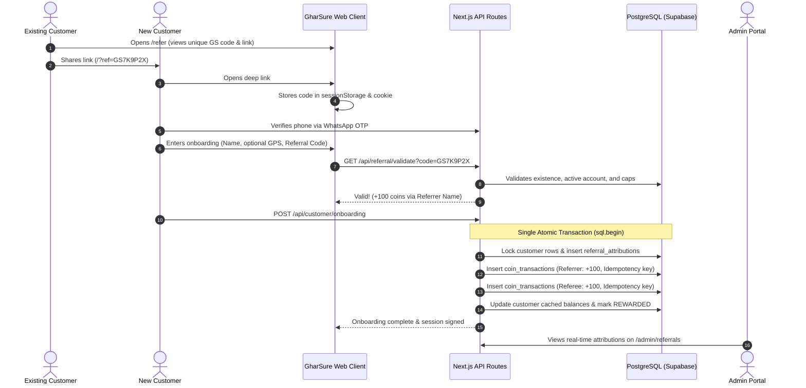

# GharSure Referral System: Complete Technical Specification & Documentation

This document provides the full end-to-end specification of the GharSure Referral Code System, covering architectural design, database schemas, cryptographic code generation, deep-link preservation, atomic reward transactions, administrative controls, and automated verification.

---

## 1. System Architecture & Workflow

The referral system links inviter (referrer) and new customer (referee) accounts through a tamper-proof, idempotent transaction pipeline.



---

## 2. Referral Code Generation Specification

### Format & Alphabet Design
- **Prefix:** `GS` (brand prefix for GharSure).
- **Entropy Body:** 6 characters selected from an unambiguous alphanumeric alphabet.
- **Total Length:** Exactly 8 characters (e.g., `GS7K9P2X`, `GS8M4W9Z`).
- **Alphabet:** `23456789ABCDEFGHJKLMNPQRSTUVWXYZ` (32 characters).
  > [!NOTE]
  > Ambiguous characters `0` (zero), `O` (uppercase o), `1` (one), `I` (uppercase i), and `L` are intentionally omitted. This prevents transcription mistakes when customers manually type codes from SMS or WhatsApp messages.
- **Search Space:** $32^6 = 1,073,741,824$ unique combinations per prefix, making codes human-readable while collision probability remains negligible.

### Database Generation Engine ([`20261024000000_referral_system_schema.sql`](file:///D:/Projects/GharSure/supabase/migrations/20261024000000_referral_system_schema.sql))
A native PL/pgSQL function automatically assigns unique referral codes upon customer creation:

```sql
CREATE OR REPLACE FUNCTION generate_unique_referral_code()
RETURNS TEXT AS $$
DECLARE
  chars TEXT := '23456789ABCDEFGHJKLMNPQRSTUVWXYZ';
  result TEXT;
  i INT;
  is_unique BOOLEAN := FALSE;
  attempts INT := 0;
BEGIN
  WHILE NOT is_unique AND attempts < 100 LOOP
    attempts := attempts + 1;
    result := 'GS';
    FOR i IN 1..6 LOOP
      result := result || substr(chars, floor(random() * length(chars) + 1)::int, 1);
    END LOOP;

    -- Verify uniqueness across customers table
    PERFORM 1 FROM customers WHERE referral_code = result;
    IF NOT FOUND THEN
      is_unique := TRUE;
    END IF;
  END LOOP;

  IF NOT is_unique THEN
    result := 'GS' || upper(substr(md5(random()::text || clock_timestamp()::text), 1, 6));
  END IF;

  RETURN result;
END;
$$ LANGUAGE plpgsql;
```

### Backend Cryptographic Generation ([`src/lib/referral.ts`](file:///D:/Projects/GharSure/src/lib/referral.ts))
In the Node.js / TypeScript environment, codes are generated using cryptographically strong pseudo-random bytes with collision retries against PostgreSQL:

```typescript
export function generateRandomReferralCode(): string {
  let result = "GS";
  const charsLength = REFERRAL_CODE_ALPHABET.length;
  const randomBytes = crypto.randomBytes(6);

  for (let i = 0; i < 6; i++) {
    result += REFERRAL_CODE_ALPHABET[randomBytes[i] % charsLength];
  }

  return result;
}
```

---

## 3. Database Schema & Integrity Constraints

### 1. `customers` Table Additions
| Column | Type | Constraints | Description |
| :--- | :--- | :--- | :--- |
| `referral_code` | `VARCHAR(30)` | `UNIQUE NOT NULL DEFAULT generate_unique_referral_code()` | Permanent customer referral identifier |
| `reward_coins` | `INT` | `NOT NULL DEFAULT 100` | Cached coin balance |

- **Index:** `CREATE INDEX idx_customers_referral_code_upper ON customers(UPPER(referral_code));`

### 2. `referral_attributions` Table
Tracks every pairing and reward lifecycle between inviter and invitee:

```sql
CREATE TABLE IF NOT EXISTS referral_attributions (
  id UUID PRIMARY KEY DEFAULT gen_random_uuid(),
  referrer_id UUID NOT NULL REFERENCES customers(id) ON DELETE CASCADE,
  referee_id UUID NOT NULL REFERENCES customers(id) ON DELETE CASCADE,
  referral_code VARCHAR(50) NOT NULL,
  status VARCHAR(30) NOT NULL DEFAULT 'PENDING' CHECK (status IN ('PENDING', 'QUALIFIED', 'REWARDED', 'REJECTED')),
  reward_coins INT NOT NULL DEFAULT 100,
  referrer_reward_coins INT NOT NULL DEFAULT 100,
  referee_reward_coins INT NOT NULL DEFAULT 100,
  rejection_reason TEXT,
  metadata JSONB DEFAULT '{}'::jsonb,
  created_at TIMESTAMPTZ NOT NULL DEFAULT NOW(),
  qualified_at TIMESTAMPTZ,
  CONSTRAINT uq_referral_referee UNIQUE (referee_id),
  CONSTRAINT check_referral_no_self_referral CHECK (referrer_id != referee_id)
);
```

### 3. `system_settings` Table
Holds the single source of truth for runtime campaign parameters:

```json
{
  "key": "referral_campaign",
  "value": {
    "is_active": true,
    "referrer_reward_coins": 100,
    "referee_reward_coins": 100,
    "max_referrals_per_customer": 50,
    "qualification_trigger": "PHONE_VERIFIED_AND_ONBOARDED"
  }
}
```

---

## 4. Atomic Reward Transaction & Concurrency Controls

Rewards are executed inside an atomic transaction using PostgreSQL row-level locks (`FOR UPDATE`) and deterministic idempotency keys:

1. **Row Locks:** Acquires `FOR UPDATE` on `referral_attributions`, `customers` (referrer), and `customers` (referee).
2. **Deterministic Idempotency Keys:**
   - Referrer credit key: `ref_referrer_${attributionId}`
   - Referee credit key: `ref_referee_${attributionId}`
3. **Dual Coin Ledger Entries:**
   ```sql
   INSERT INTO coin_transactions (
     customer_id, amount, type, description, idempotency_key, metadata
   ) VALUES (
     ${referrerId}, ${referrerReward}, 'REFERRAL_BONUS',
     'Referral bonus for inviting neighbor', ${referrerIdempotencyKey}, ...
   ) ON CONFLICT (idempotency_key) DO NOTHING;
   ```
4. **Balance Synchronization:** Increments `customers.reward_coins` for both accounts inside the same transaction block.
5. **State Transition:** Updates `referral_attributions.status = 'REWARDED'` and sets `qualified_at = NOW()`.

> [!IMPORTANT]
> If a user refreshes or double-clicks "Proceed" on onboarding, the unique constraints and `ON CONFLICT DO NOTHING` guarantees that coins are never duplicated.

---

## 5. Security & Anti-Abuse Controls

| Threat Vector | Mitigation Strategy |
| :--- | :--- |
| **Self-Referral** | Enforced at DB level with `CHECK (referrer_id != referee_id)` and checked in API via `currentCustomerId === referrer.id`. |
| **Multiple Attributions per User** | Enforced via `uq_referral_referee UNIQUE (referee_id)`—a customer can only ever be attributed once. |
| **Suspended / Deleted Accounts** | Invalidation check rejects referral codes belonging to `SUSPENDED` or `DELETED` accounts. |
| **Referral Farming / Caps** | Enforces `max_referrals_per_customer` (default: 50) checked at validation time. |
| **Sequential Guessing** | Codes use random 32-character base rather than sequential integers or auto-incrementing IDs. |
| **Campaign Toggles** | Authorized administrators can toggle `is_active: false` to halt new reward issuances immediately. |

---

## 6. Deep-Link Capture & User Experience

1. **Deep Link Ingestion ([`ReferralParamCapturer`](file:///D:/Projects/GharSure/src/components/referral-param-capturer.tsx)):**
   - Automatically detects `?ref=CODE` on any entry URL (`/`, `/auth`, `/onboarding`).
   - Persists into `sessionStorage` (`gharsure_pending_ref`) and cookie for cross-tab and cross-step preservation during OTP verification.
2. **Live Feedback Onboarding ([`src/app/onboarding/page.tsx`](file:///D:/Projects/GharSure/src/app/onboarding/page.tsx)):**
   - Pre-populates stored referral code.
   - Debounced (450ms) background validation against `/api/referral/validate`.
   - **Valid State:** Green border and badge: `✓ Code applied! +100 welcome coins via {referrerName}`.
   - **Invalid State:** Red border with error text.
   - **Clear Button:** Allows 1-click removal of referral codes.
3. **Customer Dashboard ([`src/app/(main)/refer/page.tsx`](file:///D:/Projects/GharSure/src/app/(main)/refer/page.tsx)):**
   - Displays real unique referral code (never `GH000001` or placeholders).
   - 1-click "Copy Code", "Copy Link", and native Web Share API integration.
   - Live metrics strip: Total Invited, Rewarded, and Coins Earned.
   - Referral activity table with masked phone numbers (`+91 98*** 43210`). Zero fake data.
4. **Admin Portal ([`src/app/admin/referrals/page.tsx`](file:///D:/Projects/GharSure/src/app/admin/referrals/page.tsx)):**
   - Real attributions table with search (by code, customer ID, name, or phone) and status filter.
   - Inline actions: Qualify, Reject with custom reason, or Reward Now (executes dual coin emission).
   - Authoritative campaign configuration modal to update bonus amounts and limits.

---

## 7. API Reference

### `GET /api/referral/validate?code={code}`
- **Auth:** Public / Optional Customer Session.
- **Response:**
  ```json
  {
    "valid": true,
    "code": "GS7K9P2X",
    "referrerId": "a44ec2d1-...",
    "referrerName": "Vikram Malhotra",
    "referrerCustomerId": "GH000001",
    "bonusCoins": 100
  }
  ```

### `GET /api/referral/stats`
- **Auth:** Required Customer Session (`gharsure_session`).
- **Response:**
  ```json
  {
    "success": true,
    "referralCode": "GS7K9P2X",
    "totalReferrals": 3,
    "pendingReferrals": 1,
    "rewardedReferrals": 2,
    "totalCoinsEarned": 200,
    "campaignBonusCoins": 100,
    "campaignRefereeBonusCoins": 100,
    "isCampaignActive": true,
    "attributions": [...]
  }
  ```

### `POST /api/customer/onboarding`
- **Auth:** Required Customer Session.
- **Payload:** `{ fullName, city, referralCode }`
- **Action:** Atomically attributes referee to referrer and emits rewards.

### `GET /api/admin/referrals?status=...&search=...`
- **Auth:** Admin Session with `referrals:read` permission.
- **Response:** Paginated list of real customer referral attributions.

### `PATCH /api/admin/referrals`
- **Auth:** Admin Session with `referrals:write` permission.
- **Payload:** `{ id, status, rejectionReason }`
- **Action:** Updates attribution state. If set to `REWARDED`, executes reward transactions atomically.

---

## 8. Automated Test Coverage ([`tests/referral.test.ts`](file:///D:/Projects/GharSure/tests/referral.test.ts))

The test suite validates the entire referral system:
- `✓ generates a code starting with GS and exactly 8 characters`
- `✓ generates unique codes with high entropy without collisions`
- `✓ validates an active customer's referral code correctly`
- `✓ is case-insensitive during code validation`
- `✓ rejects non-existent referral codes with INVALID_CODE`
- `✓ prevents self-referral when candidate matches current customer id`
- `✓ atomically attributes referral and awards coins to both referrer and referee`
- `✓ is idempotent: re-submitting does not issue duplicate rewards`
- `✓ returns correct stats for customer with active attributions`
